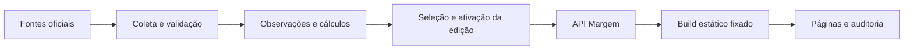

# Margem — Roadmap

## Objetivo

Este documento organiza a evolução do Canal Margem do site editorial atual até uma primeira versão funcional da plataforma socioeconômica.

Ele descreve etapas e resultados esperados, não datas. Os valores numéricos nos exemplos são ilustrativos.

Cada etapa poderá posteriormente ser quebrada em milestones, issues e tarefas menores.

---

## Fase 0 — Conhecer e organizar o projeto existente

### Objetivo

Criar uma base segura para evolução sem perder o que já funciona.

### Trabalho

#### Auditoria do codebase

Levantar:

- stack;
- dependências;
- organização;
- rotas;
- componentes;
- estilos;
- design tokens;
- assets;
- build;
- testes;
- linting;
- deploy;
- CI/CD;
- analytics existentes;
- SEO existente.

#### Auditoria visual

Identificar:

- cores;
- tipografia;
- espaçamento;
- ícones;
- ilustrações;
- grid;
- padrões editoriais;
- componentes reutilizáveis.

#### Documentação

Adicionar:

```text
01-project-vision.md
02-product-design.md
03-technical-architecture.md
04-roadmap.md
```

Criar a estrutura dentro de `docs/`:

```text
research/
adr/
data-sources/
systems/
```

### Resultado esperado

O projeto existente está compreendido e documentado.

Nenhuma grande implementação nova é necessária nesta fase.

---

## Fase 1 — Fundação do produto e design system

### Objetivo

Transformar a identidade visual atual em uma base reutilizável para a futura plataforma.

### Trabalho

Identificar ou criar tokens para:

- cores;
- tipografia;
- spacing;
- radius;
- borders;
- shadows;
- breakpoints;
- largura de conteúdo;
- hierarquia textual.

Consolidar componentes básicos:

- Button;
- Link;
- Card;
- Container;
- Section;
- Heading;
- Tooltip;
- Drawer;
- Modal;
- Tabs;
- Badge;
- Search;
- Select;
- Skeleton;
- Empty State;
- Error State.

Criar os primeiros componentes específicos do Margem:

- IndicatorCard;
- SourceBadge;
- DataFreshness;
- MethodologyWarning;
- Trend;
- TimeRangeSelector;
- ExplanationDrawer.

### Resultado esperado

Os tokens e componentes editoriais existentes são consolidados e ampliados para formar o design system reutilizável da plataforma.

---

## Fase 2 — Modelo conceitual dos dados

### Estado

Especificada em [Modelo conceitual dos dados](systems/data-model.md), com [exemplos fictícios](systems/examples/data-model.json) de metadados, revisão histórica, ausência e cálculos derivados. O [catálogo de operações](systems/data-operations.md) complementa a fase com leituras, escritas e garantias de consistência, incluindo aceitação e publicação. A entrega é conceitual: não implementa schema executável, banco, ingestão ou engine. A seleção de indicadores está registrada na fase 3 abaixo.

### Objetivo

Definir como o Margem entende indicadores antes de construir bancos e pipelines.

### Trabalho

Definir entidades como:

```text
Theme
Indicator
IndicatorSeries
Observation
Source
Dataset
Methodology
Geography
Unit
Policy
GovernmentPeriod
```

Definir relações.

Exemplo:

```text
Theme
  ↓
Indicator
  ↓
Series
  ↓
Observation
```

Definir metadados obrigatórios:

```text
value
unit
reference_period
geography
source
dataset
published_at
retrieved_at
methodology_version
vintage
revision_status
```

Definir como representar indicadores derivados.

Exemplo:

```text
renda por hora
tempo de trabalho por litro de gasolina
horas de trabalho por cesta básica
```

### Resultado esperado

Modelo conceitual independente de banco de dados ou framework.

---

## Fase 3 — Definição do MVP de indicadores

### Estado

Definida em [Indicadores do MVP](systems/mvp-indicators.md): 15 conceitos principais nas cinco dimensões, com cesta básica, tempo pelo salário mínimo, insegurança alimentar e ônus de aluguel. O mínimo real usa INPC; jornada, participação, subutilização e inadimplência acompanham a leitura como contexto. Dívida bruta passa a uma entrega posterior. O [mapa de fontes](research/source-map.md) registra as evidências e as investigações pendentes. A seleção não implementa dados ou páginas; fontes, inputs e comparabilidade operacional ainda exigem o catálogo da fase 4.

### Objetivo

Evitar começar tentando integrar centenas de séries.

Selecionar aproximadamente 10–15 indicadores que permitam validar o produto.

### Candidatos

O levantamento abaixo registra os candidatos originais. A lista escolhida e os motivos de adiamento estão em [Indicadores do MVP](systems/mvp-indicators.md).

#### Trabalho e renda

- rendimento real;
- rendimento por hora;
- salário mínimo real;
- horas trabalhadas;
- desemprego;
- informalidade.

#### Custo de vida

- IPCA;
- alimentação;
- cesta básica;
- gasolina;
- habitação.

#### Vida financeira

- comprometimento da renda;
- inadimplência ou endividamento.

#### Qualidade de vida

- pobreza;
- desigualdade.

#### Economia e Estado

- PIB per capita;
- dívida pública;
- investimento.

A lista definitiva deverá priorizar indicadores:

- compreensíveis;
- relevantes;
- historicamente comparáveis;
- com fontes confiáveis;
- tecnicamente simples de manter.

### Resultado esperado

Lista oficial dos indicadores do MVP.

---

## Fase 4 — Catálogo de fontes

### Estado

Documentada no [catálogo de fontes](data-sources/README.md): matriz dos 15 principais, contextos e inputs, fichas de IBGE, BCB, ANP, Conab/DIEESE e FJP, com recortes e obtenção identificados, histórico observado, método, quebras, direitos e amostras oficiais. As [investigações complementares](research/phase-4-investigations.md) têm conclusão. A [auditoria](data-sources/verification.md) registra a validação e os limites. Acesso pontual não comprova integração recorrente ou comparabilidade entre todas as edições; a implementação continua na fase 5.

### Escopo definido pela fase 3

Catalogar os 15 indicadores principais, contextos e entradas auxiliares de INPC, mínimo nominal e cesta por capital. As fontes necessárias são IBGE, Banco Central, ANP, Conab/DIEESE e Fundação João Pinheiro. Concluir também a investigação de renda/hora publicada pelo IBGE, Peic/CNC e inflação por faixa de renda/Ipea, sem presumir novas integrações. Tesouro, MDS, MTE, ANEEL, SINISA, Inep e DATASUS permanecem no [mapa de expansão](research/source-map.md).

### Objetivo

Mapear exatamente de onde virá cada dado do MVP.

### Trabalho

Criar documentação para as fontes necessárias.

O levantamento original de fontes candidatas foi:

```text
IBGE
Banco Central
Ipea
Tesouro Nacional
ANP
DIEESE
```

A revisão inclui explicitamente Conab/DIEESE e Fundação João Pinheiro; a prioridade atual é a do escopo acima. A presença de uma fonte no levantamento não implica integração automática.

Para cada indicador:

```text
indicator
source
dataset
series_id
endpoint/file
frequency
historical_range
geographic_resolution
methodology
known_breaks
```

Criar uma matriz:

```text
Indicador
↓
Fonte
↓
Dataset
↓
Série
↓
Frequência
↓
Pipeline necessário
```

### Resultado esperado

Nenhum indicador do MVP existe sem uma fonte identificada.

---

## Fase 5 — Prova de conceito de ingestão

### Entrada do catálogo

Implementar TR4 (IBGE `4099/4099`), CV1 (IBGE `1737/63,2265`) e VF1 (BCB SGS `29265`), três indicadores e quatro séries externas de duas fontes, contando separadamente as duas medidas de CV1. Consultas e amostras estão no [catálogo da fase 4](data-sources/README.md). A PoC deve distinguir trimestre civil, mês e média móvel trimestral, testar revisão histórica e repetição sem mudança e preservar os originais antes de normalizar. Implementada na [PoC local](systems/ingestion.md):
coleta real de 587 observações, repetição sem novas versões, histórico, logs, retries e
exportação JSON. Revisões e falhas foram verificadas em cenários controlados; armazenamento
definitivo e operação recorrente seguem para as fases 6 e 7.

### Objetivo

Provar o fluxo completo de dados utilizando poucas fontes.

### Escopo recomendado

Começar com duas fontes:

- IBGE;
- Banco Central.

Selecionar entre três e cinco séries.

### Pipeline

```text
Fetch
 ↓
Validate
 ↓
Raw Store
 ↓
Normalize
 ↓
Persist
 ↓
Expose
```

Implementar:

- idempotência;
- logs;
- timestamps;
- retries básicos;
- armazenamento raw;
- validação de schema;
- controle de atualização.

### Resultado esperado

Uma série oficial consegue percorrer automaticamente todo o caminho entre a fonte e o Margem.

---

## Fase 6 — Arquitetura de armazenamento

### Estado

Definida em [Arquitetura de armazenamento](systems/storage.md), com
[medição da PoC](systems/evidence/storage/measurement.json) e [cinco ADRs](adr/README.md):
PostgreSQL 18, API e jobs na Railway; raw privado no Cloudflare R2; histórico imutável/publicação
transacional, projeções cacheáveis e retenção por dependência na operação normal. Recuperação
usa backup nativo diário da Railway ou reconstrução pelas fontes disponíveis, com possível
perda de versões antigas após desastre.
O ADR-0005 registra portabilidade e orçamento de referência, sem autorizar gastos.
Banco analítico e cache distribuído não serão adotados inicialmente. Migração e restauração
têm critérios definidos, sem RPO/RTO fixos; o tempo de recuperação será medido. A entrega é documental,
sem provisionamento ou alteração do fluxo da PoC; a implementação começa com a fase 7.

### Objetivo

Tomar decisões baseadas na prova de conceito, não em especulação.

### Decisões

Avaliar:

- banco principal;
- object storage;
- armazenamento raw;
- banco analítico, se necessário;
- cache;
- retenção;
- versionamento;
- backups.

Criar ADRs para as decisões relevantes.

Exemplos:

```text
ADR-0001 Primary Database
ADR-0002 Raw Object Storage
ADR-0003 Data Versioning
```

### Resultado esperado

Infraestrutura de armazenamento definida e documentada.

---

## Fase 7 — Pipeline de dados do MVP

### Estado

Implementada nos [pipelines do MVP](systems/pipelines.md). O [ADR-0007](adr/0007-go-modular-backend.md)
registra a migração integral para Go, os módulos de domínio, comandos/consultas e pgx/sqlc.
Jobs independentes para IBGE,
BCB, ANP, Conab/DIEESE e FJP cobrem os recortes externos e inputs selecionados; não são
necessários jobs Ipea/Tesouro para este escopo. Há migração PostgreSQL e armazenamento raw por hash e
criação condicional, com cliente da API compatível com S3 do Cloudflare R2, schema/quality checks, revisões, recibos, locks, cadência e observabilidade.
A [execução local](systems/evidence/pipelines/verification.json) aceitou 6.375 observações desde
2012 e repetiu sem novas versões; preservou a PoC sem retirá-la. Dockerfile e cron Railway
estão preparados. Operação remota, bucket lock R2 e backup nativo permanecem sem ensaio.
TR2/CV5 serão calculados na fase 8; publicação/ativação permanecem na fase 9.

### Objetivo

Integrar todas as fontes necessárias para os indicadores selecionados.

### Trabalho

Criar jobs independentes por fonte.

Exemplo:

```text
IBGE ingestion
BCB ingestion
ANP ingestion
Tesouro ingestion
Ipea ingestion
DIEESE ingestion
```

Criar mecanismos de:

- agendamento;
- retry;
- schema validation;
- quality checks;
- versionamento;
- observabilidade.

Separar:

```text
raw
normalized
derived
published
```

### Resultado esperado

Os dados necessários para o MVP são atualizados automaticamente.

---

## Fase 8 — Indicator Engine

### Estado

Implementada na [engine de indicadores](systems/indicator-engine.md), no backend Go.
TR2, CV5, relações cesta/renda, variações, diferenças, base 100 e acumulados compostos usam
inputs aceitos fixados por ID, fórmulas versionadas, precisão de 12 casas e half-even.
Avaliações e dependências são imutáveis e transacionais; incompatibilidades registram motivo
sem número. Testes cobrem repetição, revisões, concorrência, rollback e dados oficiais
preservados. A conferência do tempo DIEESE também detectou e corrigiu deslocamento de
colunas em cinco custos históricos. API e seleção/ativação pública continuam na fase 9.

### Objetivo

Separar dado bruto de interpretação e cálculo.

### Responsabilidades

Calcular:

- variações;
- valores reais;
- índices;
- comparações temporais;
- relações renda/preço;
- tempo de trabalho;
- indicadores compostos permitidos.

Cada cálculo deverá ter:

```text
formula
version
inputs
output
methodology
```

Nenhum cálculo relevante deve existir apenas dentro de um componente do frontend.

### Resultado esperado

Cálculos são centralizados, reproduzíveis e testáveis.

---

## Fase 9 — Margem API

### Estado

Implementada na [API Margem](systems/api.md): manifesto com seleção explícita e catálogo
fixado, projeção imutável, ativação por geração, retorno e recibos transacionais; HTTP v1
com temas, indicadores, séries, fontes, auditoria e comparações. Inclui cache HTTP, filtros,
paginação, erros consistentes e proteção local contra abuso. A [verificação](systems/evidence/api/verification.json)
comprova coleta oficial IBGE → PostgreSQL → publicação → API, repetição sem novas versões,
revisões e falhas controladas. A PoC foi retirada após preservar 21 arquivos e 587 observações.
A integração do shell é a fase 10. Implantação Railway/R2 e comportamento da CDN continuam
sem ensaio remoto.

### Objetivo

Criar um contrato estável entre dados e produtos.

### Primeiros recursos

Exemplo conceitual:

```text
GET /themes
GET /themes/:slug

GET /indicators
GET /indicators/:slug

GET /indicators/:slug/series

GET /sources/:id

GET /comparisons
```

A API deverá retornar tanto valores quanto contexto necessário para interpretação.

### Requisitos

- cache;
- paginação quando necessária;
- filtros;
- versionamento;
- documentação;
- erros consistentes;
- proteção contra abuso.

### Resultado esperado

Frontend não conhece IBGE, BCB ou qualquer outro provedor.

Ele conhece apenas o contrato do Margem.

### Critério de transição para a fase 10 — retirada da PoC

A sequência permanece: arquitetura e armazenamento (6), integrações reais (7), cálculos (8),
API própria (9) e integração do frontend (10). O frontend da plataforma consome o contrato
do Margem; a coleta das fontes oficiais pertence aos jobs do backend.

Quando o backend e a API substituírem o fluxo experimental da fase 5, a retirada da PoC é
parte obrigatória da conclusão desta transição, antes de integrar o frontend:

- Incorporar ao backend os adaptadores, validações e testes que continuarem necessários,
  ajustando-os à arquitetura escolhida; remover suas versões experimentais ou duplicadas.
- Remover a CLI e a persistência provisórias, o comando `pnpm ingestion` e configurações,
  testes, fixtures e capturas usados exclusivamente pela PoC. Não manter uma segunda
  implementação funcional ou uma pasta de arquivo morto dentro do repositório.
- Preservar a proveniência e o histórico necessários à auditoria dos dados. Evidências raw
  ainda necessárias devem ter destino no armazenamento apropriado, definido na fase 6,
  antes de retirar as cópias experimentais. Manter na suíte apenas fixtures úteis aos testes
  do sistema definitivo.
- Atualizar README, documentação, comandos e configuração de cobertura para descrever o
  sistema vigente, conservando somente o registro histórico conciso das decisões e resultados.
- Comprovar o fluxo real `job → persistência → API`, com origem rastreável, repetição sem
  duplicação, revisão histórica e tratamento de falhas. Conferir que código, testes e
  documentação ativos não dependem dos artefatos removidos e executar as validações afetadas.

A substituição foi verificada na fase 9 e a implementação TypeScript foi retirada. O critério
abaixo permanece como registro da transição: depois dela, somente o
código incorporado ao backend, os testes relevantes e a documentação necessária permanecem;
os mecanismos descartáveis da experimentação são apagados.

---

## Fase 10 — Shell da nova experiência

### Estado

Implementada no [shell da plataforma](systems/platform-shell.md): entrada na home,
cinco temas socioeconômicos em `/tema/:slug`, indicadores, entrada do comparador e guia Entenda.
As rotas editoriais `/temas/:slug` permanecem. O build fixa publicação, catálogo e recortes
da API no HTML e nos links JSON. Sem API configurada, mostra definições e indisponibilidade.
Verificação local inclui build com API HTTP controlada, navegação sem JavaScript, SEO e
acessibilidade automática; operação remota permanece não verificada. A experiência completa
das páginas e o comparador interativo continuam nas fases seguintes.

### Objetivo

Integrar a nova plataforma ao site existente preservando a identidade atual.

### Criar

```text
/
```

Home evoluída.

```text
/tema/:slug
```

Página temática.

```text
/indicador/:slug
```

Página do indicador.

```text
/comparar
```

Comparador.

```text
/entenda/:slug
```

Conteúdo educacional.

### Resultado esperado

O site editorial atual evolui gradualmente para o shell da plataforma.

---

## Fase 11 — Home orientada a perguntas

### Estado

Implementada na [home orientada a perguntas](systems/question-home.md): a pergunta inicial
é o título principal da home, seguida por cinco entradas em linguagem cotidiana. Cada uma
leva a um tema e permite chegar a um indicador em dois cliques, inclusive sem JavaScript.
Vídeos, cortes, temas editoriais, análises e demais seções continuam abaixo. A verificação
local cobre desktop/celular, teclado, acessibilidade automática, SEO e builds com e sem
publicação da API. A compreensão por usuários reais ainda precisa ser observada; a página
temática completa continua na fase 12.

### Objetivo

Validar a principal hipótese de UX.

A entrada não será uma lista de indicadores.

Será:

> O que você quer entender?

Áreas iniciais:

- Trabalho e renda;
- Custo de vida;
- Vida financeira;
- Qualidade de vida;
- Economia e Estado.

### Resultado esperado

Usuários chegam às informações sem precisar conhecer terminologia econômica.

---

## Fase 12 — Página temática

### Estado

Implementada nas [páginas temáticas](systems/theme-pages.md): cinco dimensões com resumo,
comparações temporais publicadas pela engine, indicadores com todos os recortes da edição,
explicações e acesso ao guia do comparador. Sem comparações ou cobertura, a página explicita
as ausências. Período, geografia, unidade, método e links de auditoria acompanham os dados;
não há cálculo de mudanças no frontend. Gráficos e experiência completa de indicador continuam
na fase 13; comparador interativo, na fase 16.

### Objetivo

Criar um nível intermediário entre pergunta e indicador.

Exemplo:

```text
Custo de vida

Quanto custa viver no Brasil?

Alimentação
Moradia
Energia
Combustíveis
Inflação
```

Apresentar:

- resumo;
- principais mudanças;
- indicadores;
- explicações;
- acesso ao comparador.

### Resultado esperado

Os dados ganham narrativa sem perder auditabilidade.

---

## Fase 13 — Página de indicador

### Estado

Implementada nas [páginas de indicador](systems/indicator-pages.md): valor por recorte,
tendência e comparação publicadas, histórico paginado com gráfico SVG e tabela auditável,
interpretação dos 15 principais, fonte, coleta, metodologia, alertas e indicadores relacionados.
HTML e links mantêm a publicação do build, com navegação sem JavaScript. Lacunas interrompem
a linha; ausência no último período não recebe um valor anterior. A verificação local cobre
precisão decimal, paginação, falhas de contexto, desktop/celular, acessibilidade automática e SEO.
A camada Entenda dedicada continua na fase 14; comparação interativa, na fase 16.

### Objetivo

Construir o componente central do produto.

Cada página deverá responder:

1. o que aconteceu?
2. o que significa?
3. como sabemos disso?

Elementos:

- valor;
- tendência;
- gráfico;
- período;
- comparação;
- interpretação;
- fonte;
- atualização;
- metodologia;
- alertas;
- indicadores relacionados.

### Resultado esperado

Primeira experiência completa de consumo de um indicador.

---

## Fase 14 — Camada “Entenda”

### Estado

Implementada na [camada Entenda](systems/entenda.md): índice e 11 páginas conceituais com
definição, importância, interpretação, erros comuns, exemplos hipotéticos, referências
primárias e indicadores relacionados. Os temas levam a conceitos pertinentes; as páginas de
indicador oferecem painel contextual com fontes, método e aprofundamento, inclusive sem
JavaScript. A verificação local cobre SEO, acessibilidade automática, teclado e builds com
e sem API. Compreensão por usuários reais e indexação externa continuam não verificadas.
A [busca da fase 15](systems/search.md) integra agora esses conceitos aos indicadores e ao acervo.

### Objetivo

Remover a necessidade de conhecimento econômico prévio.

Criar conteúdo para conceitos como:

- inflação;
- renda real;
- renda nominal;
- PIB;
- PIB per capita;
- dívida pública;
- déficit;
- juros;
- Selic;
- informalidade;
- desigualdade.

Cada conceito deverá responder:

- o que é;
- por que importa;
- como interpretar;
- erros comuns;
- indicadores relacionados.

### Resultado esperado

A plataforma também funciona como mecanismo de alfabetização econômica.

---

## Fase 15 — Busca

### Estado

Implementada em [Busca por linguagem cotidiana](systems/search.md): aliases específicos, normalização de acentos e pontuação, filtros e índice estático com indicadores do catálogo do build, conceitos do Entenda e acervo editorial. Inclui recuperação de erros e catálogo navegável sem JavaScript. Verificação local por testes unitários, navegador e build isolado; operação pública e indexação externa não verificadas.

### Objetivo

Permitir linguagem cotidiana.

Exemplos:

```text
comida
gasolina
salário
aluguel
dívida
```

devem encontrar os indicadores tecnicamente relacionados.

Inicialmente não é necessário utilizar IA.

Taxonomia, aliases e full-text search podem resolver grande parte do problema.

### Resultado esperado

O usuário não precisa conhecer o nome oficial de uma série.

---

## Fase 16 — Comparador

### Estado

Implementada no [comparador](systems/comparator.md): seleção de temas, vários indicadores,
recortes e extremos temporais, com diferença absoluta ou variação percentual calculada
pela API na publicação do build. Regras versionadas explicitam melhora, piora e igualdade
por medida; preços nominais, inflação e outras séries sem direção favorável inequívoca
exigem contexto. Ausência, incompatibilidade e falha de consulta são distintas de estabilidade.
Cada resultado expande períodos, valores, fórmula, regra, fontes e observações usadas.
Verificação local cobre backend, integração, build e navegador em desktop/celular, com
SEO, axe e catálogo sem JavaScript. Governos dependem da fase 18; não há score agregado
nem atribuição de causalidade. A tradução em tempo de trabalho está na fase 17.

### Objetivo

Permitir análise histórica sem produzir um score político opaco.

Usuário seleciona:

- períodos;
- indicadores;
- temas;
- eventualmente governos.

Resultado:

```text
melhorou
piorou
estável
sem dados suficientes
```

Cada conclusão deverá ser expansível até os dados utilizados.

### Resultado esperado

Primeira ferramenta analítica propriamente dita do Margem.

---

## Fase 17 — Tempo de trabalho

### Estado

Implementada em [Tempo de trabalho](systems/work-time.md): cesta em reais, percentual do
salário mínimo bruto e horas/minutos, nas páginas de cesta e tempo por cesta. O backend
reutiliza CV5/1 e price-income/1, com referência de 220 horas mensais, inputs da mesma
publicação/mês e auditoria. Ausência, renda incompatível e divergência com a fonte impedem
conversão. Verificação local cobre HTTP, PostgreSQL/S3, revisões, build, desktop/celular,
SEO e acessibilidade automática sem JavaScript. Outras rendas/hora e gasolina continuam
como expansão; operação remota e compreensão por usuários reais não foram verificadas.
A fase 18 acrescenta o contexto de políticas públicas e linha histórica.

### Objetivo

Implementar uma das principais características conceituais da plataforma.

Converter preços em equivalentes como:

```text
R$
% da renda
minutos de trabalho
horas de trabalho
```

Exemplo:

```text
1 litro de gasolina
R$ 6,20

ou

18 minutos de trabalho
```

### Resultado esperado

Indicadores abstratos passam a ter tradução material imediata.

---

## Fase 18 — Políticas públicas e linha histórica

### Estado

Implementada em [Políticas e linha histórica](systems/policy-history.md): catálogo editorial
validado de políticas, legislação, governos, vigências por dispositivo e relações com
indicadores. Quatro políticas federais iniciais têm fontes oficiais, limites e revisão
editorial explícita. Índice, páginas e JSON público são estáticos; gráficos de indicadores
mostram faixas de contexto no mesmo eixo de datas da série, com intervalos completos e
auditoria. A busca inclui políticas. Verificação local cobre contratos, build com API
controlada, desktop/celular, teclado, ausência de dados, SEO e acessibilidade automática.
Não há atribuição causal, score político ou seleção por governo no comparador. Estudos de
impacto pertencem à fase 19; compreensão por usuários e indexação externa não verificadas.

### Objetivo

Começar a conectar indicadores a decisões políticas.

Criar modelo para:

```text
Policy
Legislation
Government
EffectivePeriod
AffectedIndicators
```

Exemplos:

- teto de gastos;
- reforma trabalhista;
- reforma previdenciária;
- política de salário mínimo;
- privatizações;
- programas de transferência de renda.

Importante:

essa camada não deve afirmar causalidade automaticamente.

Ela estabelece contexto temporal e relações investigáveis.

### Resultado esperado

Usuário consegue visualizar política e dados na mesma linha histórica.

---

## Fase 19 — Evidência e causalidade

### Estado

Implementada em [Evidência e causalidade](systems/evidence.md): catálogo editorial validado
de estudos e metodologias, fichas estáticas e JSON, vínculos às políticas e aos indicadores,
busca e critérios de inferência. A classificação distingue análise descritiva/contábil,
estimativa causal condicionada e referência metodológica; contrafactual, hipóteses,
resultados e limites são explícitos. Os estudos empíricos iniciais tratam do programa
Bolsa Família anterior a 2023, sem atribuir seus resultados à nova lei. Não há reprodução
das estimações, score ou aplicação automática de efeitos às séries. Verificação local
cobre contrato, build com API controlada, navegação sem JavaScript, desktop/celular,
SEO e acessibilidade automática. Indexação externa e compreensão por usuários não verificadas.

### Objetivo

Distinguir claramente:

```text
aconteceu durante
```

de:

```text
foi causado por
```

Criar modelo para associar:

- pesquisas acadêmicas;
- estudos de impacto;
- notas técnicas;
- avaliações;
- metodologias.

Classificar evidências quando aplicável.

### Resultado esperado

A plataforma não usa simples correlação temporal como argumento causal.

---

## Fase 20 — Calculadora socioeconômica

### Estado

Implementada na [calculadora socioeconômica](systems/calculator.md): perfil de renda,
composição familiar, despesas, capital/mês, vínculo e prioridades; orçamento e cenário
hipotético calculados no backend, referência publicada de cesta e tempo pela renda individual.
Políticas e estudos relacionados exibem motivos, resultados históricos, métodos e limites.
O catálogo atual não sustenta efeito individual ou elegibilidade; o cenário não é um efeito
atribuído a políticas. O perfil não é persistido, incluído na URL ou cacheado. A página
preserva métodos e fontes sem JavaScript; a simulação depende da API Margem. Verificação
local cobre contrato, precisão, falhas, build com API controlada, desktop/celular, SEO e axe.
Operação remota, indexação externa e compreensão por usuários permanecem não verificadas.

### Objetivo

Somente depois que dados, comparação, UX e metodologia estiverem maduros, desenvolver a ferramenta originalmente imaginada.

Entrada possível:

- renda;
- região;
- vínculo de trabalho;
- composição familiar;
- aluguel/moradia;
- transporte;
- prioridades socioeconômicas.

Saída:

> Estas políticas possuem estes impactos históricos e estimados sobre as dimensões que mais afetam o seu perfil.

Não:

> Vote no candidato X.

### Resultado esperado

Ferramenta baseada em indicadores auditáveis e metodologia explícita.

---

## Fase 21 — Escala e performance

### Estado

Implementada em [Escala e performance](systems/performance.md): benchmarks locais
reproduzíveis, avaliação das nove alternativas e duas otimizações medidas. O cache de
projeções verificadas tem teto de duas edições/16 MiB serializados e TTL de 60 s, com
autorização por publicação no PostgreSQL em cada leitura; aliases e perfis pessoais ficam
fora dele. A expiração de IPs usa fila limitada em vez de varredura completa por requisição.
Verificação local cobre concorrência, expiração, falhas, isolamento e fluxo PostgreSQL/S3.
Os resultados sintéticos não comprovam carga de produção. CDN, réplicas, filas e banco
analítico permanecem condicionados a demanda observada; implantação remota continua posterior.

### Objetivo

Preparar o sistema conforme uso real justificar.

Avaliar:

- CDN;
- edge cache;
- response cache;
- materialized views;
- precomputation;
- replicas;
- filas;
- processamento incremental;
- banco analítico dedicado.

Não adotar infraestrutura complexa antecipadamente.

### Resultado esperado

Arquitetura escala de acordo com demanda observada.

---

## Fase 22 — Observabilidade e operação

### Estado

Implementada localmente em [Observabilidade e operação](systems/operations.md): `/metrics`
registra volume e latência HTTP com rótulos limitados, sinais do processo e do cache; `/readyz`
confere se há publicação ativa; os jobs registram duração estruturada; `pnpm pipeline monitor`
retorna falha quando fontes, cobertura ou frescor estão insalubres. Coletor, notificações,
frontend publicado e entrega de alertas dependem da implantação e configuração do webhook ou
scheduler.

### Objetivo

Garantir confiabilidade contínua.

Monitorar:

- APIs externas;
- pipelines;
- jobs;
- freshness;
- dados ausentes;
- mudanças de schema;
- erros;
- latência;
- cache;
- API;
- frontend.

Criar alertas para dados desatualizados.

### Resultado esperado

É possível saber rapidamente quando algum dado deixou de ser atualizado corretamente.

---

## Fase 23 — Auditoria e transparência pública

### Objetivo

Transformar rastreabilidade em parte visível do produto.

Permitir ao usuário visualizar:

```text
Indicador
↓
Cálculo
↓
Série
↓
Dataset
↓
Fonte
```

Quando possível oferecer:

- fonte original;
- metodologia;
- fórmula;
- histórico de revisões;
- dataset.

### Resultado esperado

O Margem consegue demonstrar de onde cada afirmação quantitativa surgiu.

---

## Fase 24 — Verificação pós-publicação

### Estado

Implementada localmente pelo comando [`pnpm deployment:check`](systems/deployment-check.md).
O comando é independente de provedor e não publica serviços. A hospedagem do frontend e a
operação Railway/R2 continuam sem validação remota.

### Objetivo

Conferir os requisitos públicos observáveis depois de publicar o site e a API.

### Trabalho

- ler `robots.txt` e percorrer os sitemaps anunciados;
- solicitar as páginas listadas e conferir status HTTP, metadados, canonical, conteúdo HTML,
  diretivas de indexação e JSON-LD;
- conferir liveness, prontidão e publicação atual quando uma origem da API for informada;
- falhar com código diferente de zero quando uma checagem não for atendida.

### Resultado e limites

Há uma verificação repetível antes e depois de uma publicação. Ela observa respostas no momento
da execução; não publica o serviço, não comprova indexação externa, nem substitui os ensaios de
cache, CORS, backup, alertas e recuperação previstos nos ADRs.

---

## Fase 25 — Experiência editorial e dados publicados de ponta a ponta

### Estado e objetivo

**Estado em 31/10/2026: parcial.** O fluxo local da geração 6 foi reconstruído e observado
da API ao HTML; o build isolado gerou 89 páginas e as auditorias automatizadas cobriram 88
rotas. Foram capturadas 19 rotas em desktop e celular; a inspeção visual manual detalhada
cobriu 11 delas, não todas as variantes nem tecnologias assistivas. A cobertura local contém 14 dos 15 conceitos
principais; TR1 continua sem valor por impedimento de base monetária. O backup mais recente
está parcial: faltam 17 objetos raw e uma projeção histórica, e `pipeline verify` retorna
código 1. Um armazenamento SeaweedFS local passou por reinício e integração Go, sem validar
o ambiente de publicação. Operação recorrente, alertas, restauração no ambiente alvo e
publicação externa seguem pendentes. Evidências detalhadas: [rotas](systems/evidence/phase-25-local/routes.md),
[cobertura](systems/evidence/phase-25-local/coverage.md),
[recortes de 2026](systems/evidence/phase-25-local/coverage-2026.md),
[recuperação](systems/evidence/phase-25-local/recovery.md) e
[build](systems/evidence/phase-25-local/README.md).

**Proposta registrada em 27/10/2026; diagnóstico visual completo e implementação pendentes naquela data.**
O responsável identificou uma diferença de qualidade entre a home e Sobre, mais trabalhadas
visualmente, e telas com texto concentrado e pouco ritmo visual, incluindo a entrada Dados.
Na análise inicial, somente a captura de Sobre estava disponível; as capturas de Dados e da
home não puderam ser lidas. Portanto, a tabela abaixo é um inventário de inspeção, não um
resultado de teste visual nem uma afirmação de que todas as rotas apresentam o mesmo problema.

O objetivo é cobrir **todas as experiências públicas**, identificar e corrigir os problemas
confirmados de UI/UX e tornar dados oficiais disponíveis e compreensíveis no percurso do
usuário. As fases 0–24 registram entregas e evidências históricas; esta fase complementa essas
entregas e não as reclassifica como ausentes ou concluídas em produção.

**Primeiro avanço em 27/10/2026:** `/dados` foi implementada como entrada editorial por
perguntas, com os cinco temas, caminhos de aprofundamento, estado da publicação e link para
`/auditoria`; o menu principal aponta para ela. O inventário integral, o piloto de indicador
e as demais famílias continuam pendentes. Inspeção inicial no navegador desktop confirmou
home com imagens e páginas `/auditoria`, `/indicador/desemprego`, `/politicas`, `/entenda`,
`/comparar`, `/calculadora` e `/evidencias` sem imagens no conteúdo principal; essa contagem
não substitui avaliação visual e funcional de todos os estados e tamanhos.

No ambiente local observado, PostgreSQL tinha 109 observações normalizadas e uma ativação;
`/api/v1/publications/current` respondia, mas a consulta à edição retornava HTTP 503.
O LocalStack não listava buckets e o build com `MARGEM_API_URL` falhou na captura da edição.
Isso é compatível com projeção indisponível, mas a causa exata não foi comprovada. O build
sem API permanece disponível e não mostra valores fictícios. Próximo passo: investigar a
configuração e recuperação dos objetos locais preservando dados existentes; verificar a
projeção e então repetir API → build → página com uma edição válida. Não confundir o
`/readyz` bem-sucedido com verificação da projeção, pois ele não a baixa.

**Avanço de UI posterior:** os indicadores receberam abertura editorial por dimensão,
aviso de ausência e destaque para valores disponíveis; o índice Entenda, Políticas e
Evidências receberam aberturas visuais e as páginas de conceitos, separação entre seções.
Essas alterações não concluem a revisão de todas as rotas, tampouco comprovam operação de
dados reais. Continua pendente a revisão visual manual integral, incluindo fichas de políticas
e evidências, comparador, calculadora, auditoria, busca e páginas editoriais.

**Ensaio local de dados:** uma nova edição com recortes de 2025 do IBGE e do BCB foi
ativada e construída no site; o HTML de desemprego foi conferido contra o banco. O build
exigiu corrigir a comparação entre timestamps equivalentes em fusos distintos. Ainda faltam
objetos raw históricos; esse primeiro ensaio não comprovou operação remota nem os dez
indicadores do MVP. Comandos, manifestos e limites estão na [evidência local](systems/evidence/phase-25-local/README.md).

**Ampliação local posterior:** os jobs das cinco fontes aceitaram novos lotes; uma edição
ampliada inclui 14 conceitos principais e deixa TR1 sem valor por causa da base monetária.
Uma edição posterior incorporou [recortes disponíveis de 2026](systems/evidence/phase-25-local/coverage-2026.md);
os períodos variam por fonte e não são uma afirmação uniforme de atualidade. A
[cobertura dos 15 conceitos](systems/evidence/phase-25-local/coverage.md) e a
[triagem técnica de rotas](systems/evidence/phase-25-local/routes.md) registram recortes e
limites. Um [ensaio de backup e restauração isolados](systems/evidence/phase-25-local/recovery.md)
reconstruiu as gerações 5 e 6, mas herdou 17 objetos ausentes. A [revisão inicial dos fluxos](systems/evidence/phase-25-local/flows.md)
inclui simulações com dados e falha da API. A auditoria automatizada das rotas passou no
artefato mais recente; a revisão visual de todas as variantes, os fluxos assistivos, a
recuperação dos objetos históricos e a operação recorrente no ambiente alvo continuam pendentes.

**Preparação de build:** `pnpm build:publication` gera um artefato local isolado e só o marca
pronto quando a geração permanece igual e o HTML corresponde à edição. O [procedimento](systems/platform-shell.md#publicação-fixada-no-build)
descreve o encadeamento proposto após ativação e a necessidade de coordenar a promoção. O
gatilho, a publicação e a operação no ambiente alvo continuam pendentes.

### Evidências e limites conhecidos

- O item “Dados” aponta para [`/dados`](../src/pages/dados.astro) em
  [`site.ts`](../src/config/site.ts). A entrada conduz à
  [auditoria](../src/pages/auditoria.astro), que apresenta edições e linhagem; a eficácia
  dos dois caminhos de descoberta e verificação ainda precisa ser testada.
- [`PlatformLayout`](../src/layouts/PlatformLayout.astro) oferece um cabeçalho comum às
  páginas da plataforma; [indicadores](../src/pages/indicador/%5Bslug%5D.astro),
  [políticas](../src/pages/politicas/index.astro) e
  [evidências](../src/pages/evidencias/index.astro) contêm várias seções explicativas.
  A densidade percebida deve ser confirmada no navegador e não inferida apenas do código.
- O [frontend da fase 0](systems/frontend.md) é uma fotografia histórica. Para o estado de
  hoje, consultar também [shell](systems/platform-shell.md), [pipelines](systems/pipelines.md),
  [engine](systems/indicator-engine.md) e [API](systems/api.md).
- Já existem coleta para cinco fontes, normalização, cálculos, publicação e API, com
  evidências locais. Isso não comprova execução recorrente nem implantação remota. Sem
  `MARGEM_API_URL`, o build gera catálogo sem observações; com API configurada, falhas da
  captura interrompem o build. Uma ativação posterior exige novo build e publicação do site
  para aparecer nas páginas estáticas. Ver [publicação fixada](systems/platform-shell.md#publicação-fixada-no-build).

### Fluxo a verificar



Este fluxo existe em código; a tarefa é verificar cada fronteira no ambiente escolhido,
resolver falhas reais e documentar a evidência. A seleção editorial é explícita: receber um
lote não o publica automaticamente. O fluxo local não prova operação em produção.

### 25.1 — Inventário e diagnóstico de UI/UX

Antes de redesenhar, iniciar a aplicação e inspecionar as rotas abaixo em desktop e celular.
Registrar URL, template e variantes de conteúdo, objetivo do usuário, problemas observados,
severidade, evidência reproduzível, estado e destino da correção. Verificar navegação,
hierarquia, concentração de texto, imagens, gráficos, legibilidade, interações, acessibilidade,
desempenho e estados vazio, erro e carregamento quando aplicáveis. Conferir com e sem dados
publicados; não depender de dados fictícios apresentados como observados.

| Família e rotas | Escopo mínimo e hipótese a verificar | Prioridade inicial |
|---|---|---|
| Entrada `/` | Home e caminhos para conteúdo e plataforma; referência visual a preservar e também inspecionar. | Alta |
| Dados `/dados` e `/auditoria` | Descoberta orientada a perguntas e consulta técnica de edição e linhagem. | Alta |
| Plataforma `/tema/:slug`, `/indicador/:slug` | Todas as dimensões e indicadores; observar gráficos, dados, ausência, recortes e método. | Alta |
| `/politicas`, `/politicas/:slug`, `/evidencias`, `/evidencias/:slug` | Catálogos e fichas; densidade, linhas do tempo, fontes e limites de causalidade. | Alta |
| `/entenda`, `/entenda/:slug`, incluindo `/entenda/como-ler-os-dados` | Índice, conceitos e guia; hierarquia, exemplos e aprofundamento. | Alta |
| `/comparar`, `/calculadora` | Formulários, resultados, erros e estados sem dados; tarefa principal e método. | Alta |
| `/busca` | Busca vazia, resultados, ausência e erro; descoberta e navegação. | Média |
| `/videos`, `/videos/:slug`, `/analises`, `/analises/:slug` | Índices e detalhes; mídias, texto, fontes, relacionados e estados vazios. | Média |
| `/temas`, `/temas/:slug` | Índice e temas editoriais; não confundir com `/tema/:slug` da plataforma. | Média |
| `/manifesto`, `/sobre` | Páginas institucionais e referência visual; leitura e adaptação móvel. | Média |
| `/404`, `/design-system` | Recuperação de erro e referência de componentes; verificar o papel público e o uso real. | Média |

Inventariar os slugs reais gerados, não apenas um exemplo por template. Agrupar variantes
equivalentes somente após conferir conteúdo e estados; registrar exceções individuais. JSON,
RSS e sitemap não são telas, mas seus contratos e links devem ser preservados ao mudar rotas.
Reconciliar o inventário com `src/pages` no início e no encerramento para incluir rotas novas.
Registrar em artefato versionado, vinculado aqui, as decisões, evidências, pendências e
justificativas das telas sem alterações necessárias. Nenhuma linha desta tabela fica
automaticamente concluída pela análise inicial.

### 25.2 — Direção de produto e piloto visual

1. Propor uma entrada de Dados voltada a perguntas do cotidiano, com indicadores, períodos,
   fontes e estados de disponibilidade. Decidir sua URL e navegação após o inventário;
   manter `/auditoria` acessível para proveniência, com links a partir dos indicadores.
2. Escolher um indicador e seu tema como piloto. Mostrar primeiro a pergunta e a leitura
   principal; apresentar visualização e contexto quando houver dados, seguidos de explicação,
   fontes, método e limitações. Ausência deve ser compreensível e nunca parecer zero.
3. Criar padrões reutilizáveis a partir do piloto: composição editorial, blocos visuais,
   gráficos com alternativa textual/tabela, hierarquia de metadados e estados de dados.
   Usar fotografia, ilustração e movimento quando ajudarem a compreensão; respeitar
   `prefers-reduced-motion` e não sacrificar legibilidade ou desempenho.
4. Aplicar e adaptar os padrões aos problemas confirmados em todas as famílias da tabela,
   inclusive estados e variantes. Para ferramentas, priorizar a tarefa e o resultado;
   para políticas e evidências, preservar as distinções entre contexto e causalidade.
   Conteúdo aprofundado deve continuar acessível; não remover ressalvas essenciais.
5. Revisar com navegação por teclado, tamanhos de tela, dados reais e sem JavaScript quando
   aplicável. Registrar antes/depois e critérios de aceitação por família.

Preservar URLs e links existentes; se uma URL pública precisar mudar, planejar redirecionamento.
Cumprir a [regra permanente de SEO e descoberta por IA](../AGENTS.md): HTML semântico e
rastreável, conteúdo principal e links sem dependência de JavaScript, metadados, canonical,
dados estruturados adequados, sitemap, acessibilidade e desempenho. Não presumir que uma
mudança visual tenha validado esses contratos.

### 25.3 — Primeira publicação de dados utilizável

1. Inventariar configuração e estado efetivo do ambiente escolhido, sem expor segredos;
   identificar banco, armazenamento, API, publicação ativa e build. Registrar se a evidência
   é local ou remota, e o que ainda não foi observado.
2. Começar por recortes viáveis de IBGE/SIDRA e BCB/SGS já definidos nos
   [indicadores do MVP](systems/mvp-indicators.md) e nas fichas
   [IBGE](data-sources/ibge.md) e [BCB](data-sources/bcb.md). Selecionar indicadores e
   períodos específicos após conferir disponibilidade, unidades, metodologia e cobertura;
   não presumir que todas as séries tenham a mesma frequência ou histórico.
3. Executar o fluxo documentado: provisionar dependências locais, migrar, coletar, verificar
   lotes e proveniência, calcular derivadas quando aplicável, preparar manifesto com seleção
   e justificativa, ativar edição, servir API e construir com `MARGEM_API_URL`. Consultar
   [pipelines](systems/pipelines.md), [engine](systems/indicator-engine.md),
   [API](systems/api.md) e [shell](systems/platform-shell.md) para comandos e contratos.
   Confirmar que edição e recortes exibidos no HTML correspondem à publicação fixada.
4. Verificar repetição, revisão, ausência, falha de fonte/API e recuperação de acordo com os
   contratos existentes. Diferenciar período de referência, coleta, divulgação e corte da
   edição; não inventar atualidade nem substituir silenciosamente um período ausente.
5. Expandir por lotes para ANP, Conab/DIEESE e FJP e para os demais indicadores do catálogo,
   respeitando arquivos, PDFs, lacunas e mudanças de metodologia descritos nas fichas.
   Registrar cobertura e bloqueios por indicador e recorte, inclusive TR2/CV5 e seus inputs.
   Arquivos oficiais não são necessariamente APIs; não criar adaptadores novos sem avaliar os existentes.
6. Definir como uma nova edição provoca novo build e publicação do site, e verificar alertas,
   disponibilidade, backups e recuperação no ambiente efetivamente escolhido. A automação
   precisa manter seleção editorial, fixação da edição e falha explícita de build. Implantar
   ou publicar externamente somente quando a ação e o destino forem autorizados.

O piloto não altera o critério do MVP de pelo menos 10 indicadores relevantes disponíveis.
Para a cobertura integral desta fase, revisar os 15 conceitos principais, seus recortes e
dependências; registrar separadamente qualquer fonte indisponível ou impedimento metodológico
com evidência, impacto e próximo passo, sem declarar o indicador disponível.

### 25.4 — Sequência, acompanhamento e conclusão

Executar 25.1 e a inspeção de ambiente de 25.3 primeiro. Em seguida, fazer o fluxo local de
dados e o piloto visual em paralelo quando suas dependências permitirem; aplicar o resultado
às demais famílias e ampliar fontes. Por fim, verificar operação e publicação no ambiente
autorizado. Em cada entrega registrar **proposto, implementado, observado e pendente**, com
data, arquivos, comandos, resultados, evidência e responsável/próxima ação. Uma proposta
aprovada não é prova de implementação ou autorização de publicação externa.

Para concluir a fase, exigir:

- inventário reconciliado com todas as rotas e slugs, cada variante com diagnóstico e
  correção verificada ou justificativa documentada de que não precisa de alteração;
- piloto e demais correções verificados em desktop e celular, com e sem dados, teclado,
  movimento reduzido, estados aplicáveis e conteúdo principal acessível sem JavaScript;
- HTML gerado, SEO, links, canonicals, JSON-LD, sitemap e rastreamento verificados nas rotas
  afetadas, além dos testes e build pertinentes; indexação externa só com evidência própria;
- pelo menos 10 indicadores relevantes disponíveis para o MVP, com fonte, período, recorte,
  unidade e limitações; os 15 conceitos e dependências auditados com cobertura explícita;
- fluxo fonte → API → build → página comprovado, incluindo falha, repetição, revisão,
  ausência, nova ativação e atualização do site; proveniência e seleção reproduzíveis;
- operação recorrente, observabilidade e recuperação verificadas no ambiente alvo; se uma
  implantação ou fonte não estiver autorizada ou disponível, registrar a fase como parcial,
  sem confundir teste local com operação remota.

Trade-offs: fotografias e gráficos exigem curadoria, créditos, acessibilidade e orçamento de
carregamento; esconder detalhes demais prejudica transparência. Publicações fixadas tornam a
edição reproduzível e isolam visitas das fontes externas, mas exigem rebuild após ativação e
operação de coleta, revisão e publicação. Fontes heterogêneas e mudanças metodológicas podem
impedir comparações contínuas ou atualização uniforme.

---

## Linha crítica para o primeiro MVP

Nem todas as fases anteriores são necessárias antes de lançar algo.

Uma primeira versão utilizável pode seguir esta sequência:

```text
0. Auditoria
↓
1. Design system
↓
2. Modelo conceitual
↓
3. Indicadores MVP
↓
4. Fontes
↓
5. Ingestion PoC
↓
6. Storage
↓
7. Pipelines MVP
↓
8. Indicator Engine
↓
9. API
↓
10. Shell
↓
11. Home
↓
12. Temas
↓
13. Indicadores
↓
14. Entenda
↓
15. Busca
↓
16. Comparador
↓
17. Tempo de trabalho
```

Políticas públicas, causalidade e calculadora socioeconômica podem evoluir posteriormente sobre uma fundação já testada.

---

## Critérios para considerar o MVP funcional

O MVP estará funcional quando:

1. dados são obtidos automaticamente de fontes oficiais;
2. o sistema preserva a origem dos dados;
3. pelo menos 10 indicadores relevantes estão disponíveis;
4. usuários conseguem navegar por perguntas e temas;
5. cada indicador possui explicação acessível;
6. gráficos apresentam contexto temporal;
7. fontes e metodologia estão visíveis;
8. usuários conseguem comparar períodos;
9. pelo menos alguns preços podem ser expressos em tempo de trabalho;
10. nenhuma página depende diretamente da disponibilidade das APIs governamentais;
11. atualizações de dados funcionam em background;
12. falhas de ingestão podem ser detectadas;
13. a identidade visual permanece coerente com o Canal Margem.

---

## Princípio de execução

O roadmap deve ser implementado de maneira incremental.

Cada fase deve responder:

> qual hipótese estamos validando?

> qual é o menor sistema necessário para validá-la?

> quais decisões precisam ser documentadas?

> o que ainda pode permanecer em aberto?

O objetivo não é construir toda a arquitetura imaginável.

É permitir que o Margem cresça sem perder rastreabilidade, clareza de produto e capacidade de evolução.
