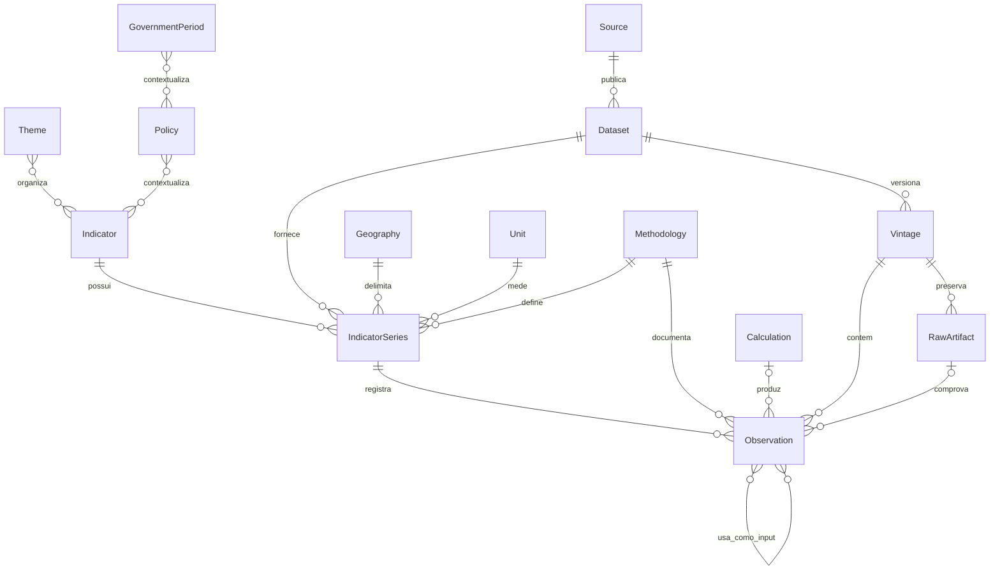
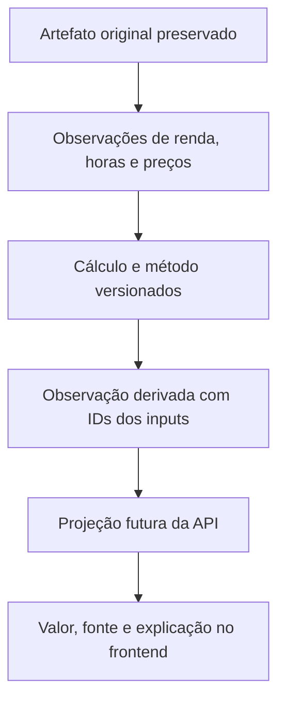

# Modelo conceitual dos dados — fase 2

## Estado e contrato da entrega

Esta fase define as entidades, relações e regras dos dados socioeconômicos do Margem. É uma especificação independente de banco, linguagem e framework, conforme a [fase 2 do roadmap](../04-roadmap.md#fase-2--modelo-conceitual-dos-dados). Não implementa armazenamento, ingestão, API ou motor de cálculo.

A hipótese é que o mesmo modelo consegue representar um dado de fonte externa, sua revisão histórica e um indicador derivado com origem verificável. Os [exemplos JSON](examples/data-model.json) exercitam esses caminhos com instituições, séries e valores fictícios. Não selecionam os indicadores do MVP nem validam fontes reais.

O contrato de conclusão inclui as onze entidades previstas no roadmap, cardinalidades, os onze metadados obrigatórios, identidade das séries e observações, revisões, valores ausentes e três cálculos derivados. A validação desta entrega exige consistência documental, referências resolvidas nos exemplos e conferência dos cálculos e cenários históricos. A implementação futura deverá verificar essas regras em execução.

O [catálogo de operações de leitura e escrita](data-operations.md) complementa esta especificação com aceitação de lotes, consultas, idempotência, concorrência, publicações imutáveis e garantias de consistência. Seus exemplos distinguem coleta, aceitação e disponibilização pública.

As regras de imutabilidade e consulta histórica valem para a operação normal e a base retida. A [política de recuperação do MVP](../adr/0004-retention-and-recovery.md) admite perda de versões após desastre: reconstruir com fontes disponíveis não garante reproduzir edições antigas. Sem o contexto original, novas capturas e publicações recebem identidades e horários próprios, sem reutilizar IDs para conteúdo diferente ou inventar eventos perdidos.

## Base e nomes canônicos

O modelo parte da [rastreabilidade exigida pela visão](../01-project-vision.md#9-transparência), das [camadas da arquitetura](../03-technical-architecture.md#5-camadas-de-dados) e da [leitura em três níveis da UX](../02-product-design.md#4-modelo-de-leitura). As coleções de [src/content.config.ts](../../src/content.config.ts) descrevem conteúdo editorial; não representam séries estatísticas. As props de [IndicatorCard](../../src/components/indicators/IndicatorCard.astro) e [DataFreshness](../../src/components/indicators/DataFreshness.astro) são contratos de apresentação, separados deste modelo.

Entidades usam nomes no singular; campos usam `snake_case`. Todo registro tem `id` estável e opaco: o consumidor não deve extrair significado dele. Slugs são rótulos de navegação mutáveis, não chaves estatísticas. Nos exemplos, IDs legíveis facilitam a conferência. Referências como `source`, `dataset`, `unit` e `geography` contêm IDs, nunca nomes de exibição.

| Conceito | Nome canônico | Regra |
|---|---|---|
| Dataset de origem | `dataset` | Substitui o nome provisório `source_dataset` |
| Revisão | `revision_status` | Substitui `is_revised`; estados `unrevised`, `revised`, `unknown` |
| Versão de metodologia | `methodology_version` | Versão imutável do método referenciado por `methodology` |
| Versão de cálculo | `calculation_version` | Versão da especificação de cálculo; substitui o `version` genérico dos exemplos de engine |
| Série externa | `source_series_id` | Código opaco preservado da fonte; `null` para série calculada internamente |
| Edição dos dados | `vintage` | ID de uma edição preservada, distinto da versão do método e do horário da coleta |

Esses nomes são do domínio. A fase 9 definirá a serialização e os recursos da API; a fase 6 decidirá a representação física. Referências repetidas em uma observação podem ser resolvidas a partir da série, mas a projeção completa deve sempre permitir recuperar os metadados abaixo sem consultar o provedor externo.

## Entidades e relações

As cardinalidades mostram o catálogo em construção: um indicador pode ainda não ter séries. Para publicação, cada indicador precisa de pelo menos um tema e uma série com observações rastreáveis. Cada série pertence a exatamente um indicador, dataset, fonte, unidade, geografia e versão de metodologia. Uma observação pertence a exatamente uma série e um vintage. A fonte da série deve ser a fonte do dataset.

| Entidade | Responsabilidade e campos |
|---|---|
| `Theme` | Dimensão socioeconômica. `id`, `slug`, `name`, `question`, `description`. Relação N:N por `Indicator.themes` |
| `Indicator` | Conceito compreensível para o usuário. `id`, `slug`, `name`, `question`, `description`, `themes`, `kind` (`source` ou `derived`), `interpretation`, `limitations`. Unidade e recorte concretos pertencem à série |
| `IndicatorSeries` | Medição homogênea do conceito. `id`, `indicator`, `source`, `dataset`, `source_series_id`, `unit`, `geography`, `frequency`, `period_type`, `population`, `dimensions`, `seasonal_adjustment`, `price_basis`, `methodology`, `methodology_version`, `calculation`, `breaks` |
| `Observation` | Um valor ou ausência explícita em um período e edição. `id`, `series`, todos os metadados obrigatórios, `methodology`, `value_status`, `release_status`, `supersedes`, `revision_note`, `raw_artifact`, `source_record_locator`, `derivation` |
| `Source` | Instituição responsável pela publicação. `id`, `name`, `kind`, `url`. Pode ser externa ou o próprio Margem; origem interna deve ser explícita. `illustrative` fica reservado a exemplos |
| `Dataset` | Conjunto publicado pela fonte. `id`, `source`, `name`, `description`, `url`, `license`, `kind` (`source` ou `derived`). URL e licença desconhecidas ficam `null` com justificativa, sem inventar permissão de uso |
| `Methodology` | Método versionado. `id`, `version`, `description`, `document_url`, `limitations`, `comparability`. O par `(id, version)` é único e imutável; um documento externo pode estar indisponível, com justificativa |
| `Geography` | Área e definição territorial. `id`, `name`, `level`, `code_system`, `code`, `boundary_version`, `parent`. Código é string; `parent` referencia outra geografia ou é `null` no topo |
| `Unit` | Significado dimensional. `id`, `symbol`, `quantity`, `currency`, `scale`, `definition`. Percentual, ponto percentual, índice, moeda, hora e moeda/hora são unidades distintas |
| `Policy` | Contexto de política pública. `id`, `name`, `description`, `geography`, `legal_references`, `effective_periods`, `related_indicators`, `government_periods`, `relationship_note` |
| `GovernmentPeriod` | Mandato ou período administrativo. `id`, `name`, `office`, `geography`, `start`, `end`, `sources`. Fim `null` significa período em aberto; não completar com a data atual |

Entidades auxiliares preservam a origem e o cálculo:

| Entidade | Campos e regra |
|---|---|
| `Vintage` | `id`, `dataset`, `kind` (`source_release` ou `calculation_run`), `source_release_id`, `published_at`, `first_retrieved_at`, `publication_note`, `order`. `order` é uma chave de ordenação das edições dentro do dataset, atribuída com evidência de sua ordem; não é uma sequência de coleta nem uma data inferida. A codificação física fica para a PoC |
| `RawArtifact` | `id`, `vintage`, `retrieved_at`, `media_type`, `sha256`, `content` ou referência ao conteúdo imutável. Guarda os bytes coletados, sem prometer um formato de storage |
| `Calculation` | `id`, `calculation_version`, `formula`, `inputs`, `output_unit`, `methodology`, `methodology_version`, `alignment`, `missing_policy`, `precision`. Descreve papéis dos inputs, unidades e regras; não executa a fórmula |

Os temas estatísticos não substituem os temas editoriais publicados em [temas.json](../../src/content/temas.json). A [seleção da fase 3](mvp-indicators.md) agrupa os indicadores nas cinco dimensões da visão; o mapeamento para o acervo e as URLs fica para o shell. Este modelo não altera `/temas/:slug`.

`Policy` e `GovernmentPeriod` são contratos conceituais mínimos. `effective_periods` contém intervalos de vigência com referências documentais; promulgação e vigência podem ocorrer em datas diferentes. `related_indicators` registra uma relação investigável com justificativa. `government_periods` registra contexto de implementação, não autoria exclusiva. Nenhuma dessas relações permite inferir efeito causal ou pontuar governos. A [fase 18](policy-history.md) concretiza esses contratos no catálogo editorial, com `Government`, legislação como entidade própria e relações `affected_indicators` explicitamente contextuais. Evidências de impacto pertencem à fase 19.

## Identidade e comparabilidade das séries

A identidade semântica de uma série é a combinação de indicador, fonte, dataset, código externo, unidade, geografia e sua versão territorial, frequência, tipo de período, população, dimensões, ajuste sazonal, base de preços, metodologia e versão; para derivadas, inclui também cálculo e versão. Dimensões são pares chave/valor canônicos, sem depender da ordem das chaves.

Alterar qualquer elemento dessa identidade cria outra série e registra sua relação com a anterior em `breaks`. Uma correção descritiva, sem mudar o significado, não cria série. Revisar o valor de um período mantém a série e cria outra observação. Trocar a metodologia não sobrescreve a série antiga, mesmo quando a fonte mantém o código externo.

- `population` identifica o universo e a estatística, por exemplo média por pessoa ocupada; média, mediana e total não são intercambiáveis.
- `dimensions` registra recortes como sexo, faixa etária, produto e vínculo. Recortes diferentes não podem disputar a mesma identidade.
- `frequency` admite `daily`, `weekly`, `monthly`, `quarterly`, `annual`, `irregular`. Frequência de referência não é calendário de atualização.
- `period_type` distingue `calendar`, `rolling`, `point`. Trimestre móvel não é trimestre civil. Um estoque numa data é diferente de fluxo ao longo do mês.
- `seasonal_adjustment` admite `adjusted`, `unadjusted`, `not_applicable`, `unknown`. Não comparar silenciosamente séries ajustadas e não ajustadas.
- `price_basis` registra `kind` (`nominal`, `real`, `not_applicable`) e `base_period` e `deflator` quando real. Índices também precisam de base explicitada na definição da unidade. Mudar base monetária ou de índice muda a identidade.
- `breaks` contém a série relacionada, o período afetado, a descrição, a referência metodológica e `comparability` (`comparable`, `not_comparable`, `unknown`). Ter a mesma unidade não basta para concluir comparabilidade.

Definições referenciadas também preservam sua identidade semântica: mudar o significado de uma unidade ou população exige outro identificador; mudar um método exige outra versão. Editar o nome de exibição não pode alterar retroativamente o significado das observações.

`Geography.code_system` identifica o cadastro do código; códigos IBGE são candidatos para territórios brasileiros, não uma exigência para toda fonte. Áreas não coincidentes não devem receber o mesmo ID por terem nomes semelhantes. Mudanças de limites exigem outra versão territorial; agregação espacial necessita de método e pesos explícitos.

## Metadados obrigatórios de observação

Cada campo abaixo deve estar presente. `null` só é permitido nas condições descritas; não substitui uma referência ausente por acidente.

| Campo | Semântica e validação |
|---|---|
| `value` | Decimal finito representado nos exemplos como string, com ponto e sem separador de milhares, `%` ou moeda. `"0"` é dado; `null` exige um `value_status` de ausência. Não aceitar `NaN` ou infinito |
| `unit` | ID de `Unit`, igual ao da série. `scale` informa o fator para a unidade base; `"5"` em percentual de escala `0.01` significa 5%, não 500% |
| `reference_period` | Objeto `{start, end, label}` com datas de calendário `YYYY-MM-DD`, início e fim inclusivos e `start <= end`. `label` é descritivo, não identidade. Um ponto usa a mesma data nas duas pontas |
| `geography` | ID de `Geography`, igual ao da série; inclui a definição territorial por referência |
| `source` | ID da instituição publicadora do valor, consistente com série e dataset. Nas derivadas é Margem; fontes dos inputs continuam rastreáveis |
| `dataset` | ID do dataset, consistente com série e vintage. Derivadas pertencem a um dataset interno identificado |
| `published_at` | Data ou instante da publicação pela fonte; aceita `YYYY-MM-DD` ou timestamp com fuso explícito, preservando a precisão disponível. `null` exige `publication_note` no vintage. Não usar fim do período ou coleta como substituto |
| `retrieved_at` | Timestamp com fuso explícito da primeira obtenção desta versão pelo Margem. Nas derivadas, instante de materialização. Nunca anterior aos inputs utilizados |
| `methodology_version` | Versão existente do método em `methodology`, consistente com a série e o cálculo quando houver |
| `vintage` | ID de edição existente. Deve pertencer ao mesmo dataset e ter a mesma publicação informada na observação |
| `revision_status` | `unrevised` se identificada como primeira edição; `revised` se há revisão declarada ou detectada em relação à anterior; `unknown` se a fonte e o histórico não permitem decidir |

Datas são válidas no calendário, não apenas strings no formato esperado. Não converter uma publicação conhecida só pelo dia em meia-noite fictícia. Uma publicação não pode estar depois da coleta: quando só o dia é conhecido, a comparação usa o dia da coleta no calendário da fonte; registrar o fuso da fonte no catálogo. O período de referência pode ser anterior à publicação por meses ou anos.

Campos complementares obrigatórios da observação:

| Campo | Regra |
|---|---|
| `value_status` | `observed`, `missing`, `suppressed`, `not_applicable`. Somente `observed` admite valor decimal não nulo; os demais exigem `value: null` e justificativa em `value_note` |
| `release_status` | `preliminary`, `final`, `unknown`. Independente de revisão: uma revisão pode continuar preliminar |
| `supersedes` | ID da observação anterior da mesma série e período, ou `null`. Quando presente, exige `revision_status: revised`; a cadeia não pode ter ciclos |
| `revision_note` | Explica uma revisão; obrigatória quando `revised`. Se a edição anterior não foi preservada, `supersedes: null` e a nota deve declarar essa limitação |
| `raw_artifact` | ID do artefato original para dados externos; `null` nas derivadas |
| `source_record_locator` | Caminho, linha ou chave que localiza o registro nos bytes originais; obrigatório para dado externo; `null` nas derivadas |
| `derivation` | `null` para dado externo. Nas derivadas: cálculo, versão, mapa de papéis para IDs exatos de observações de entrada, parâmetros e instante de cálculo |

Um campo não coberto por um caso condicional deve ser explicitamente `null` nos exemplos. `value_note` só é obrigatório para ausência; uma observação numérica pode usá-lo para contexto.

Uma observação externa precisa de artefato do mesmo vintage, coletado no instante indicado; o localizador precisa levar ao valor ou à ausência na fonte. Em derivadas, `derivation.calculated_at` e `retrieved_at` coincidem; o método e a unidade de saída devem concordar com a especificação do cálculo. Evidência externa não pode ser substituída por um link genérico à instituição.

### Ausência, erro e atualização

Não confundir `value: "0"`, ausência explícita e inexistência de observação. Uma falha de download é estado do futuro job; não cria observação zero ou `missing`. Ausência explícita registra o que a fonte publicou, inclusive supressão por sigilo.

Atualização (`current`, `delayed`, `unknown`) pertence ao estado operacional da série, com política de publicação e última tentativa. Não decorre de `revision_status` ou `release_status`. Uma série anual com referência antiga pode estar em dia; uma coleta recente pode conter dados atrasados. Essa política será definida com o catálogo e os pipelines.

## Vintages, revisões e consulta histórica

A chave lógica de uma observação é `(series, reference_period.start, reference_period.end, vintage)`. Não pode haver dois valores divergentes para essa chave. O `id` identifica permanentemente esse registro. Normalizar o mesmo conteúdo novamente reutiliza a identidade: outra tentativa de coleta não cria uma revisão.

O vintage identifica uma edição do dataset. Usar o identificador de edição da fonte quando confiável; quando não houver, a futura ingestão deverá identificar a edição por conteúdo e contexto de publicação, não pelo relógio de cada tentativa. Hashes e localizadores preservam a evidência de cada conteúdo. Dois arquivos de uma mesma edição podem coexistir; o hash de um único arquivo não define necessariamente a edição inteira.

Registros publicados são imutáveis. Revisão cria novo vintage e nova observação; preserva a anterior com `supersedes`. Valor igual com nova publicação, novo estado preliminar/final ou nova evidência pode ser outra edição válida. Uma correção de normalização feita pelo Margem também precisa de nova versão rastreável, justificativa e ligação ao raw original; não deve se passar por revisão anunciada pela fonte. O desenho do identificador dessa edição local fica para a PoC.

| Consulta | Regra conceitual |
|---|---|
| Último valor disponível de cada período | Entre edições verificadas da mesma série e período, selecionar o maior `Vintage.order`. Uma ausência explícita nova substitui o valor na visão atual, sem apagá-lo do histórico |
| O que o Margem havia aceito em um instante `T` | Considerar apenas observações com `retrieved_at <= T` e `AcceptanceBatch.accepted_at <= T`, selecionando a edição mais recente elegível por período. Coleta sem aceitação não integra a visão normalizada; não usar `published_at` para antecipar conhecimento |
| O que estava disponível no canal público em `T` | Resolver o último evento de ativação até `T` e ler seu manifesto completo, conforme o [catálogo de operações](data-operations.md). Aceitação interna não implica disponibilização pública |
| O que a fonte havia publicado até `T` | Exige histórico de edições da fonte e precisão de publicação suficiente. Datas sem horário ou edições não coletadas limitam a resposta; retornar essa limitação, sem reconstruir conhecimento inexistente |
| Reprodução de um resultado | Resolver os IDs dos inputs preservados; nunca substituir cada input pelo valor mais recente |

Uma edição antiga coletada depois de uma nova não se torna atual pela ordem de coleta. Sua chave de ordenação precisa permitir inserção na posição correta sem mudar as identidades já publicadas; não usar um contador de chegada como ordem de edição. Se a ordem de publicação não puder ser estabelecida, o dataset permanece com ambiguidade explícita e não permite anunciar um valor como definitivo. Um cálculo novo de inputs antigos é uma nova materialização, mas não deve se tornar o resultado atual automaticamente: a seleção de derivadas precisa conferir também os vintages dos inputs e a versão de cálculo escolhida.

Nos exemplos, a renda de agosto é `3000` na edição coletada em 15/09 e `3300` na revisão coletada em 01/10. A visão em 20/09 usa `3000`; a atual usa `3300`. A coleta de outubro não altera o resultado reproduzido com os inputs de setembro. A ausência de gasolina em setembro não apaga a observação de agosto.

Essa seleção representa a visão interna depois da aceitação das respectivas edições. Os [exemplos de operações](examples/data-operations.json) acrescentam os recibos de aceitação e ativações: a revisão coletada às 12:00 de 01/10 entra na visão interna às 12:01 e só fica pública na ativação das 12:08. Um retorno posterior pode reativar a publicação antiga sem apagar o conhecimento interno.

## Indicadores derivados

Um indicador `kind: derived` tem séries com `source_series_id: null`, fonte Margem, dataset interno e `calculation` que fixa o par `(id, calculation_version)`. Cada saída referencia observações de entrada imutáveis, inclusive outras saídas derivadas. O grafo de dependências deve ser acíclico. `Calculation.inputs` descreve o contrato dos papéis; `Observation.derivation.inputs` registra os IDs realmente usados.

| Derivada | Fórmula e unidade | Condições |
|---|---|---|
| Renda por hora | `hourly_income = monthly_income / monthly_hours`, em BRL/h | Renda e horas mensais da mesma população, recorte e base de preços; horas estritamente positivas |
| Tempo de trabalho por litro de gasolina | `minutes_per_liter = price_per_liter / hourly_income * 60`, em min/L | Preço em BRL/L e renda em BRL/h compatíveis; renda estritamente positiva; parâmetro `minutes_per_hour: 60` |
| Tempo de trabalho por cesta básica | `hours_per_basket = basket_price / hourly_income`, em h/cesta | Preço da cesta definida no método e renda compatíveis; renda estritamente positiva |

### Alinhamento e limitações

- O padrão desta fase exige geografia e período idênticos. Se frequência, período ou cobertura diferirem, o cálculo não é elegível. Agregação ou aproximação exige transformação identificada, método e inputs preservados; não fazer junção pelo mês do rótulo.
- Preço nominal deve usar renda nominal na mesma moeda e período. Valores reais exigem mesma base e deflator compatível. Converter base é outro cálculo versionado.
- Preço deve ser não negativo; horas e renda no denominador devem ser maiores que zero. Denominador zero, input ausente/suprimido, quebra incompatível ou recorte divergente impede saída numérica; a avaliação deve registrar o motivo. Não gerar infinito nem preencher com zero.
- Não imputar, interpolar ou carregar o último valor sem método explícito. `missing_policy` dos exemplos é `do_not_compute`; não materializa saída quando falta input válido.
- Horas semanais não são horas mensais. Uma conversão como `52/12` só é permitida se explicitamente assumida e versionada; os exemplos já usam horas mensais.
- Dividir médias produz uma razão de médias, não a média das rendas individuais por hora. Registrar essa limitação e o universo usado. Tempo equivalente de trabalho não é despesa efetiva de toda família nem renda disponível após tributos.
- A especificação do cálculo define precisão e arredondamento. Os exemplos usam decimais exatos e divisão com até 12 casas decimais, arredondamento `half_even`; a apresentação pode arredondar sem alterar os inputs ou armazenar o texto formatado como dado.
- Alterar fórmula, regra de alinhamento, conversão, precisão ou tratamento de ausência incrementa `calculation_version`. Alterar o método de interpretação também requer versão metodológica adequada. Não recalcular histórico silenciosamente.

O exemplo inicial usa renda de `3000` BRL/mês, `200` horas/mês, gasolina a `6` BRL/L e cesta a `750` BRL/cesta, todos fictícios. Produz `15` BRL/h, `24` min/L e `50` h/cesta. Com a revisão da renda para `3300`, uma nova saída produz `16.5` BRL/h; a saída de `15` e seus inputs permanecem disponíveis. As duas derivadas de preços antigas continuam reproduzíveis, mas precisam de recomputação para compor uma visão atual consistente com a renda revisada. Isso especifica a invalidação necessária à futura engine, não a implementa.

## Camadas e integração futura

| Camada | Conteúdo e relação com este modelo |
|---|---|
| `raw` | Bytes imutáveis e metadados de `RawArtifact` associados ao vintage; preserva também evidência não aceita na normalização |
| `normalized` | Observações externas padronizadas, com origem, unidade, período, recortes e versão de normalização rastreáveis |
| `derived` | Observações calculadas e sua linhagem; usa as mesmas entidades de série e observação, sem criar uma segunda definição de indicador |
| `published` | Projeção validada das observações externas ou derivadas para os produtos, fixada em manifesto imutável e disponibilizada por ativação; publicação não implica cálculo novo |

`Indicators` da arquitetura corresponde ao catálogo e à projeção `published`; `Derived Indicators` corresponde a indicadores `kind: derived`. Essas são responsabilidades lógicas, sem determinar tabelas, buckets ou serviços.

O futuro adaptador de apresentação resolve IDs em nomes, formata valor/unidade e período, converte timestamps em datas para `DataFreshness` e fornece avisos de metodologia. `DataFreshness.status` hoje mistura atualização, estado preliminar e revisão; o adaptador deverá definir precedência ou a interface deverá expor dimensões separadas. Não persistir esse status visual como verdade estatística. `Trend` dependerá de cálculo de comparação explícito, com base temporal e avaliação contextual; revisão e crescimento numérico não significam melhora por si sós.

O modelo não exige mudanças no frontend nesta fase. Quando houver páginas públicas de indicadores, permanece obrigatória a [regra de SEO e descoberta por IA](../../AGENTS.md): HTML legível, fontes, metodologia, datas, metadados, canonical e links rastreáveis. O JSON de exemplo não é um feed de dados de produção.

## Critérios para os próximos contratos executáveis

| Cenário | Resultado obrigatório |
|---|---|
| Referência a fonte, dataset, unidade, geografia, método, série ou vintage inexistente | Rejeitar o registro; não publicar número sem origem |
| Metadados da observação divergem da série, dataset ou vintage | Rejeitar; não corrigir silenciosamente |
| Mesmo período e vintage com valores divergentes | Sinalizar conflito; não sobrescrever |
| Mesmos bytes e mesma edição coletados novamente | Reutilizar a observação; registrar a tentativa separadamente |
| Fonte revisa um período já conhecido | Preservar ambas as observações e a relação de substituição |
| Revisão de método, recorte, unidade, base ou território | Outra série e relação de comparabilidade explícita |
| Ausência declarada, supressão e zero | Estados distintos; apenas zero entra como número |
| Publicação desconhecida | `null` com motivo; coleta continua obrigatória |
| Cálculo com denominador zero ou inputs incompatíveis | Sem resultado numérico; motivo verificável |
| Input revisado depois de uma saída | Preservar a saída antiga; marcar necessidade de recomputação da visão atual |
| Consulta histórica anterior à coleta de uma revisão | Excluir essa revisão, mesmo se a publicação externa é anterior |
| Política e indicador coincidem no tempo | Apenas contexto temporal; nenhuma causalidade automática |

Os exemplos incluem todas as entidades e referências, uma revisão, ausência explícita, publicação desconhecida e três fórmulas com inputs identificados. Eles documentam instâncias válidas; não são um schema executável nem comprovam rejeição automática de instâncias inválidas. Esta tabela orienta os testes da futura ingestão e engine.

## Validação da entrega

Em 15/10/2026, a conferência local dos exemplos verificou referências das onze entidades e das auxiliares, unicidade das sete séries e dez observações, consistência dos metadados, calendário, timestamps, quatro vintages, dois hashes SHA-256 e localizadores nos conteúdos raw fictícios. A conferência pontual em Python também verificou os três cálculos e quatro saídas, ausência de ciclos na linhagem e nas revisões, preservação dos inputs antigos e seleção histórica antes e depois da revisão. Isso valida estas instâncias, sem implementar um validador geral do modelo.

Foram conferidos 120 links locais da documentação e sete fragmentos Markdown. `pnpm test` passou: 46 testes unitários com os limites de cobertura existentes, Biome, checagem Astro sem diagnósticos, build de 38 páginas e 35 testes Playwright, incluindo a integração de conteúdo. A suíte existente verificou também HTML, metadados, canonicals, links, JSON-LD, sitemap e rastreamento. Esses testes protegem o site atual; não executam ingestão ou fórmulas do novo modelo. Não houve validação de fontes reais, publicação ou indexação externa.

## Decisões e limites da fase

Ficam definidos os nomes canônicos, identidades, metadados, estados e linhagem. Isso permite selecionar os 10–15 indicadores da fase 3 e catalogar suas fontes na fase 4 sem confundir conceito, série e edição.

O [catálogo de operações](data-operations.md) define a unidade de publicação, a distinção entre aceitação e disponibilização e a regra de derivadas pendentes: não misturar input revisado com resultado antigo na visão atual. A política específica de cada publicação deverá declarar quais resultados são obrigatórios e quais indisponibilidades admite.

A [fase 3](mvp-indicators.md) fixa a seleção inicial dos indicadores e identifica fontes preliminares. Continuam em aberto: catálogo verificável de séries reais, correspondência da taxonomia editorial, calendários de atualização, codificação de correções locais, schemas executáveis, formatos de transporte, precisão necessária por indicador, armazenamento e APIs. A PoC deve testar estes conceitos com edições reais antes de fixar infraestrutura. Não há evidência de coleta, comparabilidade real ou operação nesta entrega.
