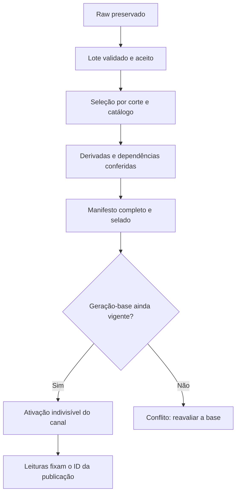

# Operações de leitura, escrita e consistência — fase 2

## Estado e critérios da entrega

Este catálogo complementa o [modelo conceitual dos dados](data-model.md). Define entradas, resultados e garantias das operações da futura plataforma, sem escolher banco, protocolo, filas ou infraestrutura. São contratos de domínio especificados; ainda não existem handlers, persistência ou garantias verificadas em execução.

A entrega deve cobrir consultas públicas e internas, ingestão, revisões, cálculos, publicação, concorrência, novas tentativas, paginação e cache. A consistência é verificada nesta fase por rastreabilidade entre operações, invariantes e [cenários fictícios](examples/data-operations.json). Os testes de execução correspondentes pertencem à PoC, à engine e à API.

## Base observada e carga esperada

Hoje, [content.ts](../../src/lib/content.ts) consulta coleções locais no build; [busca.json.ts](../../src/pages/busca.json.ts) gera um índice estático consumido por [search.ts](../../src/scripts/search.ts). Conteúdo editorial é alterado em arquivos e publicado por novo build. Esses fluxos não implementam as operações de indicadores deste catálogo.

A [arquitetura](../03-technical-architecture.md#10-estratégia-para-grandes-volumes-de-leitura) prevê muitas leituras e atualizações espaçadas. Ingestões pouco frequentes podem inserir grandes lotes ou revisar anos de histórico. Navegação e gráficos tendem a ler projeções prontas; auditoria percorre referências preservadas; escrita ocorre em background. Na elaboração da fase 2, frequência, volume e latência ainda não haviam sido medidos com fontes reais. A [medição da fase 6](storage.md#evidências-da-poc) acrescenta contagens e bytes da PoC, sem benchmark de carga.

## Contexto de leitura e registros auxiliares

Uma leitura pública usa uma publicação imutável. Ao abrir uma página ou iniciar comparação, o consumidor resolve uma publicação e transmite seu ID nas leituras seguintes, inclusive paginação e exportação. A publicação fixa os dados, suas dependências e a revisão do catálogo. Essa separação lógica entre escrita e leitura pode existir no mesmo banco.

| Registro conceitual | Conteúdo e responsabilidade |
|---|---|
| `CatalogRevision` | `id`, `created_at`, `parent`, conteúdo ou manifesto das versões de temas, indicadores, séries, fontes, datasets, unidades, geografias, métodos, cálculos e contexto de políticas. Correções de apresentação geram outra revisão; significados estatísticos continuam seguindo as identidades do modelo |
| `AcceptanceBatch` | `id`, `vintage`, `normalization_version`, `coverage`, `observation_ids`, `accepted_at`, `fingerprint`. Recibo imutável de aceitação de um lote completo na área normalizada ou derivada. `coverage` identifica séries e períodos efetivamente cobertos, sem prometer cobertura de todo o dataset. `normalization_version` é `null` nas derivadas, que fixam cálculo e versão em sua linhagem |
| `Publication` | `id`, `channel`, `base_activation`, `catalog_revision`, `data_cutoff`, `scope`, `manifest`, `manifest_digest`, `built_at`, `ready_at`, `quality_report`. Fixa observações selecionadas por série/período, indisponibilidades, fórmulas e toda a linhagem necessária à reprodução. O manifesto é selado quando pronto |
| `PublicationActivation` | `id`, `channel`, `generation`, `publication`, `previous_activation`, `activated_at`, `reason`. Evento imutável de troca da publicação ativa. `generation` cresce a cada ativação, inclusive retorno a uma publicação anterior; `activated_at` é o instante confirmado de efetivação |
| `OperationReceipt` | `id`, `operation`, `actor`, `idempotency_key`, `request_fingerprint`, `state`, `resource_ids`, `recorded_at`, `error`. Registra o desfecho de um comando e permite recuperar o resultado após timeout. Tentativas e mudanças de estado são eventos; não editam observações |

Esses registros são auxiliares lógicos, não tabelas obrigatórias. `scope` identifica o conjunto de séries/períodos e resultados exigidos naquela publicação. O primeiro canal é `public`; sua publicação contém a visão completa desse escopo, inclusive referências carregadas de publicações anteriores. Não existe fallback implícito para outro manifesto quando falta um item.

Antes da primeira ativação, o canal tem geração lógica `0`, sem publicação disponível. W07 compara essa base e cria a primeira ativação com geração `1`. As seguintes aumentam a geração em uma unidade, inclusive W08.

Uma observação aceita pertence a um único recibo canônico de aceitação. Nova tentativa recupera esse recibo; não atribui outro `accepted_at` ao mesmo registro. Aceitação de dados externos exige raw preservado e validação concluída. Aceitação de derivadas exige inputs já aceitos ou pertencentes ao mesmo lote indivisível: nesse caso, o grafo interno precisa ser acíclico, validado e calculado em ordem de dependência antes da aceitação conjunta. Artefatos inválidos podem permanecer na área raw para investigação, sem ingressar nas leituras normalizadas ou públicas.

### Três momentos distintos

| Momento | Significado |
|---|---|
| `retrieved_at` | Obtenção da versão na fonte; nas derivadas, materialização. Preserva a semântica do modelo |
| `accepted_at` | Efetivação da aceitação validada dentro do Margem; nunca anterior à obtenção/materialização ou à aceitação de suas dependências |
| `activated_at` | Momento em que uma publicação completa foi disponibilizada pelo canal, na autoridade de publicação |

`published_at` continua sendo publicação pela instituição fonte; não substitui nenhum desses momentos. Uma coleta pode preceder a normalização por horas. Por isso, a consulta interna de dados conhecidos em `T` exige tanto `retrieved_at <= T` quanto `accepted_at <= T`. Para saber o que estava disponível no canal, usa-se o histórico de ativações. Não retroagir timestamps de aceitação ou ativação para o horário em que um job começou. Dentro de um canal, `activated_at` não retrocede; ativações no mesmo instante ordenam pela geração.

Nas derivadas, a fonte é o próprio Margem: `published_at` identifica a emissão da edição de cálculo, que nos exemplos coincide com sua materialização. Esse horário não anuncia disponibilidade no canal público; a disponibilização continua sendo determinada pela ativação.

## Garantias de consistência

| ID | Garantia obrigatória |
|---|---|
| G01 | **Identidade e integridade:** referências resolvidas, metadados compatíveis e um registro canônico para cada chave lógica. Mesmo ID/chave com conteúdo divergente é conflito |
| G02 | **Histórico preservado na base retida:** observações aceitas, métodos versionados, raw e manifestos selados permanecem imutáveis. Revisão acrescenta registros e liga a edição anterior |
| G03 | **Aceitação indivisível do lote declarado:** todas as observações de um `AcceptanceBatch` tornam-se aceitas juntas, com um `accepted_at`, ou nenhuma. Staging parcial não participa de consultas |
| G04 | **Publicação indivisível:** o canal aponta para um manifesto completo e pronto. Falha na preparação mantém a publicação ativa anterior |
| G05 | **Leitura consistente por publicação:** todas as partes de uma resposta, comparação, página ou sequência paginada usam o mesmo `publication` e `catalog_revision` |
| G06 | **Linhagem coerente:** resultados atuais usam os inputs selecionados no manifesto para os mesmos recortes/períodos e a versão de cálculo fixada. Um input revisado impede reutilizar silenciosamente a saída anterior |
| G07 | **Novas tentativas sem duplicar efeitos:** mesma chave de idempotência e mesmo conteúdo devolvem o resultado original. Mesma chave com outro conteúdo é conflito. A unicidade de domínio também vale entre chaves diferentes |
| G08 | **Concorrência detectável:** alterações de catálogo e ativação exigem a revisão/geração esperada. Escritas concorrentes não resolvem divergência pela última chegada |
| G09 | **Tempo verificável:** coleta, aceitação, publicação da fonte e ativação têm papéis distintos. Consultas históricas usam o corte apropriado e não incluem eventos futuros |
| G10 | **Cache sem mistura:** dados cacheados incluem a identidade da publicação e dos parâmetros. Propagação atrasada pode servir uma publicação anterior completa, com sua identidade e datas explícitas |

As garantias G03, G04 e G08 são requisitos de resultado observável. A implementação pode usar staging, manifesto, transação ou outra técnica que os preserve. Não há exigência de uma transação única cobrindo downloads e cálculos de todo o pipeline.

Essas garantias descrevem a operação normal e o histórico retido. A [política de recuperação do MVP](../adr/0004-retention-and-recovery.md) admite perda de capturas, recibos, ativações e versões após desastre. Restaurar o banco exige conferir também as dependências no R2 antes de disponibilizar publicações. Uma reconstrução sem o contexto original cria novas capturas e publicações com horários reais; não reutiliza IDs/URLs antigos para conteúdo diferente nem inventa eventos perdidos. Consultas em `T` ficam limitadas ao histórico sobrevivente; contexto perdido deve ser informado explicitamente, sem fallback para a publicação atual.

Depois de reconhecer W03/W05, a autoridade de aceitação deve permitir recuperar o lote inteiro por seu recibo e incluí-lo em R06 quando o corte informado abranger `accepted_at`. Depois de reconhecer W07/W08, uma resolução R07 na autoridade deve observar essa geração ou uma posterior. Uma réplica atrasada não pode afirmar que confirmou esse reconhecimento: deve encaminhar a leitura à autoridade ou informar que ainda não consegue satisfazê-la. Leituras públicas já fixadas em uma publicação anterior permanecem válidas nesse contexto.

## Catálogo de leituras

As operações R01–R05 usam apenas publicações já ativadas no canal. Publicações candidatas são acessíveis somente ao processamento autorizado. R06 e R08 são internas; a futura API definirá autenticação e permissões. Nenhuma leitura pública consulta diretamente o provedor ou provoca escrita de domínio.

| Operação | Entradas e resultado | Seleção e garantia |
|---|---|---|
| R01 — Navegar no catálogo | Publicação, tema opcional, texto de busca opcional, cursor e tamanho de página → temas, indicadores e séries disponíveis com definições e limitações | Busca, nomes e disponibilidade vêm do catálogo fixado; nenhum número sem referência à publicação. G01, G05, G10 |
| R02 — Ler resumo de indicador | Publicação, indicador e série ou recorte completo → último período coberto, valor/ausência, unidade, fonte e atualização | Recorte ambíguo devolve opções ou erro explícito. Seleciona o maior fim de período no escopo; ausência no período mais recente não é substituída pelo último valor numérico. Uma comparação exige base identificada. G05, G06 |
| R03 — Ler série temporal | Publicação, série, `from`, `to`, cursor e tamanho de página → observações selecionadas, lacunas e avisos de comparabilidade | Intervalo inclusivo; inclui períodos inteiramente contidos (`start >= from`, `end <= to`). Não corta ou rateia trimestres. Ordem por `(reference_period.start, reference_period.end, observation.id)`, crescente. G01, G05 |
| R04 — Comparar ou exportar | Publicação, séries, períodos inicial/final e especificação versionada de comparação → valores, diferenças, interpretação permitida e IDs usados | Toda entrada pertence ao mesmo manifesto e passa pelas regras de comparabilidade. Ausência/incompatibilidade produz resultado com motivo, sem zero artificial. Exportação inclui publicação, catálogo, método e proveniência. G05, G06 |
| R05 — Auditar valor e revisões | Publicação, ID da observação e cursor opcional → método, inputs por ID, raw/localizador e revisões já disponíveis nesse contexto | Acesso limita-se ao manifesto e à sua linhagem autorizada. Uma publicação antiga não revela revisões posteriores; consultar outra publicação é ação explícita. G01, G02, G05 |
| R06 — Consultar conhecimento interno em `T` | Instante com fuso, série, intervalo e recorte de catálogo → observações aceitas até `T`, sua qualidade registrada e origens | Aplica coleta e aceitação até `T`; entre edições elegíveis por período usa `Vintage.order`. Metadados e avaliações também usam revisões/eventos existentes até `T`, sem acrescentar explicações futuras. Não promete reconstruir dados da fonte nunca coletados. Não equivale à visão pública. G02, G03, G09 |
| R07 — Resolver publicação do canal | Canal e instante opcional `T` → publicação, catálogo, corte de dados e evento de ativação | Sem `T`, resolve a ativação vigente na autoridade. Com `T`, usa a última ativação efetivada até `T`. Antes da primeira, retorna ausência explícita. O ID retornado fixa R01–R05. G04, G08, G09 |
| R08 — Consultar operação e atualização | ID do recibo ou job/série → estado, tentativas, último sucesso, cobertura aceita e falhas | Uma falha de coleta não altera observações. Estado operacional inclui `observed_at` e é separado dos dados estatísticos fixados numa publicação. G03, G07, G09 |

### Limites e paginação

Filtros de séries e recortes usam IDs canônicos. Datas inválidas, `from > to`, tamanho não positivo, parâmetro desconhecido ou cursor incompatível são rejeitados. Os limites máximos de intervalo, itens por resposta e custo de comparação serão configurados na API com evidência da PoC; até lá não há promessa de consulta ilimitada.

O cursor é opaco e vincula operação, publicação, filtros normalizados, ordenação e última chave lida. Em R01 a ordem estável é `(slug, id)` do tipo listado; em R05, revisões ordenam por `(Vintage.order, observation.id)` dentro da mesma série/período. Não transferir um cursor para outro contexto. Uma ativação entre páginas não muda o conjunto paginado. Se o contexto não estiver mais acessível, retornar erro explícito e solicitar reinício; não continuar na publicação atual.

Consultas internas R06/R08 também precisam de um corte consistente quando paginadas: o recibo da consulta fixa `T` e os IDs/posições dos eventos visíveis no início. Tentativas ou aceitações posteriores não entram nas páginas restantes. A representação do cursor fica para a fase 9.

### Resultados sem número e erros

Ausência de correspondências nos filtros é resultado vazio válido. ID inexistente no contexto é `not_found`; item existente sem cobertura é `not_covered`; ausência informada pela fonte preserva `value_status`; processamento pendente informa seu motivo na projeção. Esses estados não equivalem a falha de infraestrutura.

Entrada malformada é `invalid_request`; recorte não resolvido é `ambiguous_selection`; quebra de comparabilidade informa `not_comparable`; cursor de outro contexto é `cursor_context_mismatch`; contexto retido que não pode ser servido é `temporarily_unavailable`; contexto removido por uma política explícita ou com perda confirmada é `context_expired`. Os nomes identificam resultados de domínio, sem fixar HTTP ou envelopes de API. O consumidor não deve transformar erro ou indisponibilidade em zero, fallback de período ou troca de publicação.

## Catálogo de escritas

Comandos são executados por responsáveis pelo catálogo, ingestão, engine ou publicação, conforme seu papel. O visitante público não escreve observações, métodos ou publicações. Todo comando informa ator, chave de idempotência e fingerprint canônico da intenção; o recibo permite distinguir sucesso, rejeição, conflito, execução em andamento e falha recuperável. A serialização do fingerprint será fixada na implementação.

A chave de idempotência é resolvida no escopo `(operation, actor, idempotency_key)`. Repetição e conflito de conteúdo referem-se a esse escopo; a identidade de domínio continua global para o recurso, de modo que jobs ou atores diferentes também não podem duplicar uma observação ou vencer a mesma geração.

| Operação | Precondições e efeito aceito | Concorrência, repetição e falha |
|---|---|---|
| W01 — Versionar catálogo | Revisão-base esperada, definições e justificativa → nova `CatalogRevision` com referências válidas; mudança de significado gera nova entidade/versão conforme o modelo | Se a base mudou, retorna conflito para revisão da intenção. Não remover registro referenciado por histórico; desativar sua oferta em nova revisão. G01, G02, G07, G08 |
| W02 — Preservar coleta | Fonte/dataset conhecidos, identidade da edição, identidade do artefato dentro da edição, conteúdo e metadados de obtenção → vintage e raw com checksum e localizador | Mesma edição, mesmo artefato e mesmos bytes reutilizam a evidência canônica e preservam a primeira coleta. Artefatos distintos podem coexistir no mesmo vintage. Bytes diferentes para o mesmo artefato na mesma edição não sobrescrevem raw; ficam como evidência de conflito, sem promoção automática. Falha/timeout registra tentativa, sem fabricar observação. G01, G02, G07 |
| W03 — Aceitar lote normalizado | Raw completo, versão de normalização, edição ordenada e cobertura declarada → observações válidas e um `AcceptanceBatch` | Unicidade pela chave de observação definida no modelo. Mesmo resultado recupera IDs/recibo originais; resultado diferente conflita, mesmo se outro job usa outra chave. Lote incompleto/inválido não se torna aceito. A forma de representar correção local de normalização permanece vinculada à PoC; até essa definição, o conflito não autoriza sobrescrita. G01, G03, G07 |
| W04 — Registrar revisão da fonte | Nova edição comprovada, observação anterior esperada e justificativa → lote aceito por W03 com novas observações e `supersedes` quando disponível | Conferir série/período, ordem das edições e ausência de ciclos. Se o predecessor esperado mudou, conflita; se for replay já concluído, recupera o resultado original. Edição antiga coletada tarde não ganha prioridade de atual. G01, G02, G07, G08 |
| W05 — Materializar derivadas | Série/cálculo versionados, inputs por IDs aceitos ou validados no mesmo lote acíclico e parâmetros → saídas reprodutíveis aceitas em lote | Identidade de execução inclui série, período, cálculo/versão, mapa canônico de inputs e parâmetros. Mesmo conjunto reutiliza saída; divergência de resultado é conflito. Input inválido/incompatível impede número. Revisão de input agenda recomputação; não edita saída antiga. G01, G02, G03, G06, G07 |
| W06 — Preparar publicação | Ativação-base, revisão do catálogo, escopo, corte de aceitação e política de qualidade → manifesto completo, validado e selado | Fixar a seleção dos dados aceitos até `data_cutoff`; resolver dependências transitivas e disponibilidade de cada item. Falha mantém candidato sem ativação. Outro dado aceito após o corte não altera o manifesto pronto. G01, G04, G06, G07 |
| W07 — Ativar publicação | Candidato pronto, manifesto verificável, `base_activation` igual à ativação vigente e geração ativa esperada → um evento de ativação, nova geração e troca indivisível do ponteiro do canal | Apenas um concorrente vence para a mesma geração. O perdedor reavalia a base e prepara outro manifesto; não apenas troca a geração esperada do candidato antigo. Ativação normal não reduz `data_cutoff`; regressão intencional exige W08. G04, G07, G08 |
| W08 — Retornar a publicação anterior | Publicação anteriormente ativada, ainda íntegra e acessível, geração esperada e motivo → nova ativação dessa publicação | A geração cresce; não reescreve eventos nem apaga a publicação substituída. Repetição recupera o mesmo evento. Se os artefatos não estiverem íntegros, rejeita. G02, G04, G07, G08 |
| W09 — Registrar estado operacional | Job/recibo conhecido, tentativa numerada e transição permitida → evento de andamento, sucesso ou falha, com cobertura e causa | Repetição não duplica o evento; agregação usa a sequência lógica de tentativas/transições, não a ordem de chegada ou o relógio remoto. Evento atrasado não substitui estado posterior; último sucesso e última tentativa são informações distintas. Não modifica valores nem datas de coleta aceitas. G02, G07, G09 |

Em W02, a identidade lógica do artefato distingue cada arquivo ou parte dentro da edição, por exemplo pelo identificador fornecido pela fonte ou pelo caminho no pacote publicado. O checksum verifica os bytes; não substitui essa identidade, pois conteúdo alterado não pode escapar da detecção de conflito apenas por gerar outro hash. Assim, `renda.csv` e `horas.csv` da mesma edição geram dois `RawArtifact` associados ao mesmo `Vintage`; coletar novamente `renda.csv` com os mesmos bytes reutiliza seu registro, enquanto bytes divergentes sob a mesma edição e identidade de arquivo ficam em conflito. O localizador de registro de uma observação continua indicando sua posição dentro do artefato, conforme o [modelo](data-model.md#vintages-revisões-e-consulta-histórica).

Em W03/W05, o lote pode representar uma partição explícita do dataset, não todo seu histórico. A publicação só declara como coberto o que está aceito e relacionado no manifesto. O tamanho e a técnica de efetivação do lote serão determinados na PoC preservando G03.

### Reconhecimento, timeout e recuperação

Antes de reaplicar precondições de um comando, procurar seu recibo canônico: uma operação já concluída retorna o resultado original, mesmo se a geração atual mudou depois. Um comando em andamento retorna seu estado/recibo; não dispara uma segunda execução independente. Se a mesma chave reaparecer com fingerprint diferente, retornar conflito.

O reconhecimento de sucesso só ocorre depois de persistir os efeitos e o desfecho recuperável. Perder a resposta após a efetivação não desfaz a operação. O chamador consulta o recibo ou repete a mesma intenção com a mesma chave; não cria outra identidade por causa de timeout. Falha antes da efetivação permite retomar staging, sempre sujeito à unicidade e às precondições de concorrência.

Não se presume entrega de mensagens exatamente uma vez. Tentativas podem se repetir; as garantias são efeitos idempotentes, referências únicas e conflitos explícitos. Bloqueios, leases ou filas podem ajudar a execução, mas não substituem a conferência da geração e da identidade na efetivação. Retenção de recibos não pode tornar um efeito antigo duplicável; a implementação deverá preservar a evidência ou a unicidade suficiente após expiração de tentativas.

## Publicação e dependências

A unidade de publicação é o manifesto do canal, não cada linha gravada. Antes de ativar, W06 precisa atribuir a cada item de `scope` uma seleção numérica, ausência publicada pela fonte ou indisponibilidade de processamento com motivo. O relatório de qualidade registra esses estados e a política usada. Itens obrigatórios pela política precisam estar prontos; sem eles, a ativação é bloqueada.

Quando uma renda é revisada, a publicação pode seguir dois caminhos explícitos: aguardar as derivadas exigidas pela política ou disponibilizar a renda nova com as derivadas afetadas indisponíveis (`pending_recalculation`). Ela não pode apresentar renda nova junto de um tempo de trabalho antigo como se ambos fossem atuais. Indisponibilidade de processamento pertence à projeção publicada; não cria `Observation.value_status: missing`, que representa ausência na fonte.

Resultados derivados numéricos do manifesto devem usar os mesmos inputs selecionados nele para seus respectivos recortes/períodos. Inputs de transformações com outro recorte/período só são permitidos quando a transformação está versionada e toda a dependência faz parte do manifesto. Atravessar uma referência antiga para auditoria não a transforma na seleção atual.

O catálogo também é fixado: alterar um nome, uma explicação ou uma fórmula no catálogo de trabalho não modifica uma publicação antiga. Correções só ficam públicas em outro manifesto. `data_cutoff` explicita até quando a aceitação foi considerada; “publicação atual” significa a mais recentemente ativada, não a última coleta existente nem uma promessa de conter todo dado oficial mais recente.

O manifesto fixa também os IDs das revisões autorizadas para auditoria até seu corte, incluindo versões anteriores que deixaram de ser a seleção atual. R05 usa essa lista e sua linhagem; não pesquisa livremente todas as observações aceitas depois. Nos exemplos, `visible_observation_ids` registra esse conjunto e `selected` registra a visão escolhida para consumo.

### Cache, páginas e propagação

A chave de cache das leituras inclui operação, publicação, revisão de catálogo, filtros normalizados, ordenação e cursor. O alias do canal pode apontar temporariamente para a publicação anterior em caches; a resposta sempre identifica qual publicação foi servida. Ao obter um ID, o consumidor usa esse contexto até terminar a página/comparação. Se o ID solicitado não estiver disponível naquele ponto de leitura, retorna indisponibilidade ou busca-o na origem; não substitui por outro.

Um build estático também fixa um único manifesto para HTML, gráficos, índices e arquivos de dados que compõem a mesma experiência. Deploy troca um conjunto completo ou preserva URLs versionadas dos artefatos antigos. A implementação deverá escolher um mecanismo que cumpra isso; não há deploy de dados implementado nesta fase. Os metadados e o conteúdo principal continuam sujeitos à [regra permanente de SEO e descoberta por IA](../../AGENTS.md).

G04 garante atomicidade na autoridade do canal; G10 permite propagação eventual até bordas e navegadores. Não se promete que todos os visitantes vejam a nova publicação imediatamente após uma ativação ou retorno. O tempo máximo de cache e a política de invalidação deverão ser definidos antes da operação, com observabilidade. Um retorno cria novo evento e invalida o alias, mas caches ainda podem servir a publicação anterior até sua atualização; nunca podem misturar manifestos em uma mesma leitura fixada.

## Cenários de aceitação

Os [exemplos de operações](examples/data-operations.json) referenciam os IDs dos [exemplos do modelo](examples/data-model.json). Seus recibos e horários de aceitação/ativação são fictícios e complementares; não alteram os horários de coleta originais.

| Cenário | Operações e evidência esperada |
|---|---|
| S01 — Coletado, ainda não aceito | W02 obtém a renda revisada em 01/10 às 12:00; W03 aceita às 12:01. R06 às 12:00:30 ainda seleciona a renda antiga; R07 também mantém a publicação anterior |
| S02 — Aceito, ainda não público | Após 12:01, R06 seleciona a renda revisada; R02 com a publicação ativa mantém a renda anterior até W07. Raw/aceitação não implicam ativação |
| S03 — Revisão com derivadas pendentes | A publicação nova seleciona renda `3300` e renda/hora `16.5`; gasolina e cesta em tempo ficam `pending_recalculation`, sem reutilizar os resultados `24` e `50` da publicação antiga |
| S04 — Preparação interrompida | Falha em W06 não produz ativação. Publicação anterior continua completa e recuperável |
| S05 — Ativação entre páginas | R01 ou R03 inicia na publicação 1; W07 ativa a 2 antes da próxima página. O cursor continua na 1 com a mesma ordem e conjunto; o exemplo usa R01 |
| S06 — Dois publicadores concorrentes | Ambos esperam geração 1. Um W07 produz geração 2; o outro retorna conflito. Não existe uma segunda troca silenciosa |
| S07 — Resposta de sucesso perdida | W07 efetiva geração 2, mas o chamador recebe timeout. Repetir a mesma chave/fingerprint recupera a ativação original, sem geração 3 |
| S08 — Mesma chave, outro conteúdo | Chave repetida com outro manifesto retorna conflito; o primeiro recibo e seus efeitos permanecem |
| S09 — Dois normalizadores | Mesma observação e mesmo conteúdo recuperam o ID e o `accepted_at` canônicos; conteúdo divergente é conflito. Lote não aceito não aparece parcialmente em R06 |
| S10 — Retorno e histórico público | W08 reativa publicação 1 como geração 3. R07 às 12:09 resolve publicação 2; às 12:11 resolve publicação 1. O histórico da geração 2 permanece |
| S11 — Cache anterior após ativação | Leitura pode receber publicação 1 completa ou 2 completa conforme propagação; resposta com partes de ambas viola G05/G10 |
| S12 — Recorte, ausência e ordem | Série ambígua exige escolha; último período ausente não vira zero ou valor anterior; cursor de outro manifesto/filtro é rejeitado. Edição coletada tarde não vence por horário de coleta |
| S13 — Publicação incompleta ou linhagem desatualizada | W06/W07 rejeitam seleção sem referência, item do escopo sem estado ou derivada numérica cujos inputs divergem da seleção do manifesto |

Os exemplos materializam S01–S03, S05–S08 e S10. Os demais cenários são critérios para testes futuros; esta entrega não executa jobs concorrentes, transações ou caches reais. A inspeção das instâncias não comprova garantias de uma infraestrutura ainda não implementada.

## Validação desta complementação

Em 15/10/2026, a revisão delimitada conferiu as oito leituras, nove escritas, dez garantias e treze cenários, sua relação com o modelo e os limites de implementação. Uma conferência pontual em Python verificou referências aos exemplos originais, quatro lotes cobrindo dez observações, horários de aceitação, fingerprints, três candidatos, duas publicações ativadas e três eventos de ativação, incluindo retorno. Também conferiu os cortes históricos, a paginação fixada e os resultados declarados para concorrência e repetição após timeout.

Como contraprovas da conferência, foram rejeitadas três alterações nas instâncias: derivada antiga com input revisado, observação futura em uma publicação antiga e item do escopo sem estado. Esse verificador pontual foi usado na revisão dos artefatos; não integra o runtime nem constitui um validador geral do domínio.

Foram verificados 139 links locais e nove fragmentos Markdown. `pnpm check` passou: Biome sem alterações necessárias e Astro com 89 arquivos, sem erros, warnings ou hints. `git diff --check` também passou. A complementação altera documentação e exemplos; não foi necessário repetir build ou testes de navegador, e não houve verificação de concorrência, cache, banco ou publicação em produção.

## Consequências e decisões posteriores

Manifestos e histórico de ativações acrescentam metadados e retenção, mas tornam reprodução, paginação e retorno verificáveis. Preparar antes de ativar aumenta o intervalo entre ingestão e disponibilização; permite servir uma publicação anterior íntegra durante processamento. Marcar derivadas como pendentes mantém a atualização das fontes visível, com disponibilidade menor explicitamente informada.

Uma publicação por canal simplifica comparações entre temas; pode exigir copiar referências e reconstruir projeções de partes não alteradas. Particionar canais futuramente exige definir uma publicação composta para leituras que os atravessam, preservando G05. Não introduzir essa complexidade sem volume observado.

A [fase 6](storage.md) define os mecanismos de armazenamento, atomicidade e unicidade,
cache e retenção para implementação posterior. Permanecem para as fases correspondentes:
identificação das correções locais de normalização, autenticação, rotas, serialização de
cursores/fingerprints, limites quantitativos e SLAs de atualização. Retenção deve preservar publicações acessíveis e suas dependências; expiração precisa ser explícita, sem reescrever consultas antigas para o estado atual. Essas escolhas deverão cumprir as garantias deste catálogo e ser verificadas com falhas e concorrência no backend definitivo.
