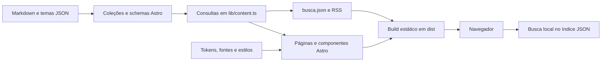

# Frontend editorial — auditoria da fase 0

Inspeção inicial em 14/10/2026, sobre a base `94e866d`, atualizada após a adoção de pnpm e Biome. Escopo: repositório `canal-margem`. O diretório irmão `video-maker` não faz parte desta alteração.

A base é um site editorial estático em Astro, mais amplo que uma landing page: possui acervo de vídeos, análises, temas, manifesto, busca e RSS. A evolução pode aproveitar essa estrutura sem migração de stack nesta fase. API de indicadores, banco e pipelines ainda não existem.

## Stack, organização e convenções

| Área | Evidência e comportamento atual |
|---|---|
| Runtime e dependências | [package.json](../../package.json): Node ≥22.13, pnpm `11.22.0`, Biome `2.5.15`, Astro `^7.3.6`, TypeScript `^6.0.3`, `@astrojs/check`, RSS, sitemap e Fontsource; versões resolvidas em `pnpm-lock.yaml` |
| Renderização | [astro.config.mjs](../../astro.config.mjs): saída estática padrão, sem adaptador de servidor; sitemap, `trailingSlash: ignore`, prefetch por hover com `prefetchAll: false` |
| Tipos e imports | [tsconfig.json](../../tsconfig.json): configuração strict do Astro e alias `@/*` para `src/*` |
| Conteúdo | [content.config.ts](../../src/content.config.ts): coleções Astro com loaders `file`/`glob`, schemas Zod e referências entre temas, vídeos e análises |
| Consultas | [lib/content.ts](../../src/lib/content.ts): filtragem de drafts em produção, ordenação, destaques, relações e helpers de URL |
| Configuração editorial | [site.ts](../../src/config/site.ts): marca, navegação, redes, contato, CTAs e newsletter |
| Componentes | `src/components/{brand,layout,ui,cards,video,sections}`; componentes `.astro`, Props tipadas, imports por alias, estilos locais e tokens compartilhados |
| Estilos | [base.css](../../src/styles/base.css): cascade layers `reset, tokens, base, layout, components, utilities`; sem Tailwind ou biblioteca de UI instalada |
| Cliente | Scripts TypeScript para busca e reveal; scripts locais nos componentes para menu, filtros, player e newsletter; sem React ou framework de estado |
| Assets | [photos.ts](../../src/data/photos.ts) centraliza imagens remotas, alt, créditos e enquadramento; `public/` contém favicon e robots; `posts/` guarda imagens sociais com URLs públicas que precisam ser preservadas |
| Formatação | [.editorconfig](../../.editorconfig): UTF-8, LF, dois espaços e newline final; Markdown preserva espaços finais |
| Git | Histórico recente usa mensagens descritivas em português. Não foram encontrados template de PR, commit lint, hooks ativos, configuração própria de branches ou instruções Claude no repositório; `.git/hooks` contém apenas exemplos. Esta entrega não cria commit |

O JSON de busca e o RSS são arquivos gerados no build, apesar de usarem handlers `GET` do Astro. Não constituem um backend operacional de dados socioeconômicos.

## Rotas e experiência existentes

As rotas derivam de [src/pages](../../src/pages). As páginas dinâmicas usam `getStaticPaths` e são pré-renderizadas a partir das coleções.

| Rota atual | Responsabilidade |
|---|---|
| `/` | Hero, vídeos em destaque, cortes, temas, manifesto, análises, newsletter e contato |
| `/videos`, `/videos/:slug` | Acervo de episódios e cortes, player, capítulos, fontes e conteúdo relacionado |
| `/analises`, `/analises/:slug` | Índice e leitura dos artigos Markdown |
| `/temas`, `/temas/:slug` | 12 pilares editoriais e conteúdo associado |
| `/manifesto`, `/sobre` | Conteúdo institucional e créditos |
| `/busca`, `/busca.json` | Interface de busca e índice estático de episódios, cortes, análises e temas |
| `/rss.xml` | Feed de episódios longos e análises |
| `/404` | Página de erro; resposta HTTP depende da configuração da hospedagem |

[BaseLayout](../../src/layouts/BaseLayout.astro) reúne fontes auto-hospedadas, CSS, SEO, header, footer, link para pular ao conteúdo e script de reveal. Não há roteador de SPA. A futura navegação Início/Indicadores/Comparar/Entenda é uma proposta de produto, ainda não aplicada.

[createSearch](../../src/scripts/search.ts) carrega o índice uma vez, normaliza caixa e acentos e exige que todos os termos apareçam, com peso maior para títulos. [busca.astro](../../src/pages/busca.astro) atualiza query string e resultados com debounce de 120 ms. Não há aliases, taxonomia socioeconômica ou busca semântica. Uma falha no fetch não possui tratamento explícito de erro/retry nesse fluxo.

## Identidade visual reutilizável

Fontes de referência: [manual de marca](../brand/MARGEM_Manual_Marca_Conteudo_Site.md), [tokens JSON](../brand/MARGEM_design_tokens.json), pranchas [P01](../brand/MARGEM_Manual_P01_Identidade.png), [P02](../brand/MARGEM_Manual_P02_Video_Social.png) e [P03](../brand/MARGEM_Manual_P03_Editorial_Site.png). Implementação em [tokens.css](../../src/styles/tokens.css), [base.css](../../src/styles/base.css) e [textures.css](../../src/styles/textures.css).

| Elemento | Base observada e aplicação futura |
|---|---|
| Paleta | Papel `#E8E2D9`, papel claro `#F2EEE7`, vermelho queimado `#8F2D24`, carvão `#1F1F1F`, preto `#0D0D0D`, concreto `#9A9A9A`, muted `#66625D`; regra 80/15/5 para manter caráter editorial |
| Papéis semânticos | `--bg`, `--bg-reading`, `--fg`, `--fg-muted`, `--accent`, linhas e variações `.on-dark`; `--red-on-dark: #C0493C` para texto sobre fundo escuro |
| Tipografia | Bebas Neue em títulos, Inter Variable em corpo/UI, IBM Plex Mono em labels e dados; imports Fontsource no layout, sem serviço externo de fontes |
| Escala | Display fluido com `clamp`, corpo base 16px, medida de leitura 66ch; labels menores, que exigirão atenção para dados essenciais |
| Espaçamento | Tokens de 4, 8, 16, 24, 40, 64, 96 e 144px, gutter e distância entre colunas fluidos |
| Layout | Conteúdo máximo 1440px; grid base de 4 colunas, 8 a partir de 720px e 12 a partir de 1080px; header muda em 960px; componentes também usam breakpoints locais |
| Forma | Raio padrão 0, máximo 4px, linhas de 1px; sem sistema de sombras como fundamento da interface |
| Fotografia e textura | Tratamento documental, grão/fibra/concreto/grunge e bordas rasgadas determinísticas em [torn.ts](../../src/lib/torn.ts); manter texturas discretas, especialmente atrás de gráficos e leitura |
| Marca e editorial | Logo com barra, destaque de um trecho de título, retalhos, rótulos mono e código `M / 000`; aproveitáveis junto de explicações e visualização de dados |
| Movimento | Tokens de 150–350ms, easing sem bounce e regras de movimento reduzido; há transições locais fora dessa faixa, como 600ms em Photo |

Os tokens CSS incluem extensões em relação ao JSON de marca; não há geração ou sincronização automática entre os dois. Breakpoints também não estão centralizados. A auditoria visual desta fase é baseada em código, manual e assets; não certifica layout renderizado, contraste de todos os estados ou comportamento assistivo em navegador.

## Candidatos ao design system

| Base existente | Reaproveitamento e limite |
|---|---|
| [Button](../../src/components/ui/Button.astro) | Link ou botão, variantes primary/outline/text e ícone; base para CTAs. Estados de loading e tratamento de ações assíncronas ainda precisam ser definidos |
| [Headline](../../src/components/ui/Headline.astro) | Elemento semântico configurável, escala e destaque editorial; base para hierarquia de títulos |
| [SectionHeader](../../src/components/ui/SectionHeader.astro), [PageHeader](../../src/components/layout/PageHeader.astro) | Cabeçalhos, labels, índices e navegação contextual |
| [Icon](../../src/components/ui/Icon.astro), [MetaLine](../../src/components/ui/MetaLine.astro) | Vocabulário de ícones e metadados; candidatos para contexto e proveniência sem presumir que já representam fontes de dados |
| [Photo](../../src/components/ui/Photo.astro) | Proporções, srcset, lazy loading, crédito e tratamento documental |
| [Prose](../../src/components/ui/Prose.astro), [ShareBar](../../src/components/ui/ShareBar.astro) | Leitura editorial e compartilhamento; base para explicações acessíveis |
| [ArticleCard](../../src/components/cards/ArticleCard.astro), [VideoCard](../../src/components/cards/VideoCard.astro), [CutCard](../../src/components/cards/CutCard.astro) | Composição editorial reaproveitável; contratos ligados a conteúdo, não a indicadores |
| [TemaFilter](../../src/components/ui/TemaFilter.astro) | Filtro com links e aprimoramento em JS; referência para seleção e anúncio de resultados, não um Tabs ou Select genérico |
| [Header](../../src/components/layout/Header.astro) | Menu mobile em `dialog` nativo; referência para foco e fechamento. O menu ainda não é um Modal ou Drawer reutilizável |
| Classes `.container`, `.grid`, `.section` | Primitives de layout já existentes como CSS; não há necessidade de convertê-las em componentes sem um caso de uso |

Não existem ainda IndicatorCard, SourceBadge, DataFreshness, MethodologyWarning, Trend, TimeRangeSelector ou ExplanationDrawer. Tooltip, Tabs, Select, Skeleton, Empty State e Error State genéricos também pertencem à fase 1. O campo e os estados de busca existentes são específicos da página.

## Build, qualidade e publicação

Comandos existentes: `pnpm dev`, `pnpm check` (Biome + Astro), `pnpm build` (check seguido de build estático) e `pnpm preview`. A instalação usa `pnpm install`; em CI, `pnpm install --frozen-lockfile`. O campo `packageManager` fixa pnpm 11.22.0 e `pnpm-workspace.yaml` autoriza o postinstall de esbuild.

O Biome está configurado em [biome.json](../../biome.json), com comandos `lint`, `lint:fix`, `format` e `format:check`. Verifica JS/TS, JSON/JSONC, CSS, SVG e o frontmatter entre `---` dos arquivos `.astro`. Markup, blocos `<script>` e CSS embutido não são verificados com a configuração atual. A detecção de imports/variáveis não usados e a organização de imports ficam desativadas apenas em `.astro`, por causa das referências nos templates.

Não há suíte ou scripts de teste automatizado, workflow CI/CD, container, configuração de provedor de deploy ou infraestrutura como código nos arquivos inspecionados.

[Seo](../../src/components/layout/Seo.astro) implementa title, descrição, canonical, Open Graph, Twitter Card, opção noindex e JSON-LD. Home e detalhes fornecem dados estruturados; sitemap vem da integração e [robots.txt](../../public/robots.txt) aponta para ele. A imagem OG padrão é uma fotografia remota, não uma thumbnail editorial composta. Não foi encontrado SDK ou script de analytics no código.

O domínio está repetido em `astro.config.mjs`, `src/config/site.ts` e `public/robots.txt`; configurar um domínio no build não comprova sua publicação. Hospedagem, DNS, headers HTTP, cache, métricas de produção e tratamento real de 404 não foram verificados.

Há fundamentos de acessibilidade em código: skip link, foco visível, alt de imagens, labels, live regions, `dialog` e movimento reduzido. O player solicita legendas ao YouTube, mas isso não comprova a existência de legendas no vídeo. O manual exige contraste AA; a cobertura de todos os estados ainda requer validação visual e assistiva na fase 1.

Dependências externas atuais no navegador são imagens Unsplash, YouTube após clique e links para redes. A newsletter está sem endpoint (`action: ''`); o JS intercepta o envio e informa indisponibilidade. Sem JS, essa interceptação não existe: revisar o estado desabilitado antes de ativar/publicar o formulário. Conteúdo, perfis, contatos e IDs de vídeo precisam da revisão editorial já prevista no README.

## Limitações e questões abertas

1. **Modelo editorial versus dados:** coleções atuais descrevem temas, vídeos e análises; não incluem observações, unidades, geografia, vintages ou metadados completos de indicadores. Definir isso na fase 2, antes de escolher banco.
2. **Taxonomia e rotas:** mapear os 12 pilares às cinco dimensões futuras; decidir convivência de `/temas/:slug` e `/tema/:slug`, links e possíveis redirects antes de mudar URLs. Não substituir silenciosamente o acervo editorial.
3. **Componentes de dados:** definir estados de falta de dados, atualização, revisão, erro e quebra metodológica. Uma cor ou seta sozinha não prova melhora ou piora.
4. **Cálculos:** não há engine de indicadores. Fórmulas, versões e inputs deverão ficar fora dos componentes, com unidades e recortes comparáveis, nas fases 2 e 8.
5. **Atualização:** o acervo depende de rebuild. Política de publicação dos futuros indicadores, cache e convivência com páginas estáticas continuam abertas.
6. **Operação:** não há backend, jobs ou observabilidade de dados. Definir tecnologias após seleção de indicadores, catálogo e PoC; registrar alternativas e consequências em ADR.
7. **Qualidade:** build e schemas verificam tipos/conteúdo, não UX, causalidade, apuração editorial ou comparabilidade de séries. Preservar essa distinção nos critérios de cada fase.

### Contraste do vermelho em fundos escuros

O token `--red-on-dark: #C0493C` tem contraste calculado de aproximadamente 3,94:1 sobre `--black: #0D0D0D` e 3,34:1 sobre `--charcoal: #1F1F1F`, considerando cores sólidas. A afirmação anterior de contraste AA sem restrições era incorreta: o [critério 1.4.3 da WCAG](https://www.w3.org/WAI/WCAG21/Understanding/contrast-minimum) exige 4,5:1 para texto de tamanho normal e 3:1 para texto grande (18pt, ou 14pt em negrito). Texturas e fundos reais ainda precisam de inspeção no navegador. Esta revisão corrige a descrição; não altera a paleta.

### Conteúdo de exemplo e publicação

O acervo em `src/content/` continua sendo material de exemplo, conforme o README. Não comprova a rastreabilidade exigida para a futura plataforma: há fontes apenas com rótulo, sem URL ou série identificada. A revisão editorial permanece pendente antes de publicar.

Há duas inconsistências concretas a resolver nessa revisão: [o episódio sobre deslocamento](../../src/content/videos/m018-duas-horas-por-dia.md) descreve o equivalente a um mês de trabalho, enquanto [a análise relacionada](../../src/content/analises/duas-horas-por-dia.md) usa três meses para uma conta semelhante; [VideoFacts](../../src/components/video/VideoFacts.astro) afirma que todos os vídeos têm legendas revisadas, mas o modelo não registra essa verificação e os exemplos não têm `youtubeId`. Essas afirmações não foram tratadas como evidência de conteúdo apurado ou publicado.

## Encaminhamento

A fase 0 entrega os quatro documentos de contexto, esta auditoria e diretórios com responsabilidades explícitas. A referência de marca foi mantida em `docs/brand`, evitando duplicação de assets. Os documentos fornecidos receberam ajustes de clareza e precisão, preservando requisitos e planos. Diferenças de nomenclatura e propostas ainda abertas estão apontadas no [índice](../README.md).

O próximo passo é a fase 1: consolidar o design system a partir dos tokens e componentes inventariados, validar responsividade e acessibilidade e especificar os estados dos componentes de indicador. Depois, seguir modelo conceitual → seleção de indicadores → fontes → PoC. Não há evidência que justifique migração de stack ou definição antecipada de infraestrutura nesta entrega.

## Validação da entrega inicial da fase 0

Registro histórico, anterior à migração para pnpm e Biome. Os comandos abaixo documentam aquela execução; para instalar e validar o estado atual, usar os comandos pnpm da seção de build.

Em 14/10/2026, com Node `v24.19.0` e npm `12.0.2`:

- `npm ci --no-audit --no-fund`: instalação concluída a partir do lockfile. O npm informou bloqueio do postinstall de esbuild; o build abaixo funcionou sem alterar a política de scripts.
- `npm run build`: `astro check` verificou 55 arquivos, com zero erros, warnings ou hints; o build estático gerou 37 páginas, índice de busca, RSS e sitemap.
- Antes da revisão documental, a comparação byte a byte confirmou que os quatro documentos numerados coincidiam com os anexos de visão, UX, arquitetura e roadmap.
- Verificação dos links Markdown locais no README e na documentação: 58 destinos existentes.
- `git diff --check`: sem erros nas alterações rastreadas; os documentos novos também foram inspecionados quanto a espaços finais, preservando o conteúdo original dos anexos.

Na entrega inicial, as alterações foram documentais, sem mudanças em `src/`, assets de marca, posts, dependências ou configuração de build. A adoção posterior de pnpm e Biome alterou a configuração de ferramentas e aplicou ajustes de formatação; esse registro histórico não descreve essas mudanças posteriores. Não foram executados testes de navegador, auditoria assistiva nem verificação de produção; esses resultados não são necessários para comprovar a organização documental e não são inferidos do build.
