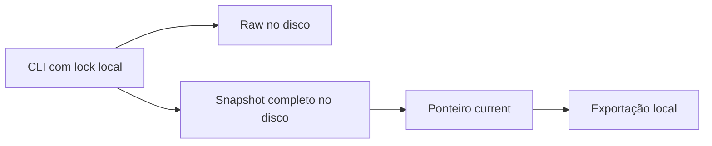
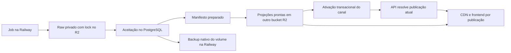

# Arquitetura de armazenamento — fase 6

## Estado e contrato da entrega

A fase 6 define o armazenamento do MVP a partir da [PoC da fase 5](ingestion.md).
As decisões estão aceitas para implementação nos ADRs abaixo. A implementação vigente
inclui agora os [pipelines da fase 7](pipelines.md), testados com PostgreSQL 18 e API S3 emulada pelo LocalStack.
Banco/buckets remotos, bucket lock R2, backup nativo e API ainda não foram provisionados
ou testados. A PoC permanece disponível e seu histórico foi preservado em `legacy`. Esta entrega é uma especificação de arquitetura, sem contratação de serviços.

| Decisão | Resultado | Registro |
|---|---|---|
| Banco principal | PostgreSQL 18; relações, observações, recibos, catálogo e publicações | [ADR-0001](../adr/0001-primary-database.md) |
| Object storage e raw | Cloudflare R2 Standard privado; bytes por SHA-256, bucket lock e proveniência no banco | [ADR-0002](../adr/0002-raw-object-storage.md) |
| Histórico e cache | Registros imutáveis, manifestos e ativação transacional; cache HTTP por publicação | [ADR-0003](../adr/0003-data-versioning-and-cache.md) |
| Retenção e recuperação | Preservar dependências na operação normal; backup nativo Railway e reconstrução, com possível perda de versões | [ADR-0004](../adr/0004-retention-and-recovery.md) |
| Hospedagem e portabilidade | Railway para API/jobs/PostgreSQL; protocolos PostgreSQL/S3 e projeções no R2 | [ADR-0005](../adr/0005-hosting-and-portability.md) |
| Banco analítico | Não adotar no MVP; reavaliar com consultas e volumes medidos | [ADR-0001](../adr/0001-primary-database.md) |

O contrato de conclusão exige medir a base existente, avaliar as oito decisões da fase 6,
registrar alternativas e consequências, preservar as garantias do modelo e definir migração,
retenção e restauração verificáveis. A revisão fecha também hospedagem, custo e portabilidade.
Execução de infraestrutura pertence às próximas fases; os critérios operacionais abaixo
são requisitos para essa execução.

## Evidências da PoC

A [medição](evidence/storage/measurement.json) foi obtida sem coletar novos dados ou alterar
`.data/ingestion/`. Registra revisão do código, snapshot, inventário, tamanhos lógicos e
SHA-256. A revisão observada é `c90f2db9b3c3d8b6243c7e38a9ef4aa3582510bf`.

| Artefato observado | Quantidade | Bytes lógicos |
|---|---:|---:|
| Raw local deduplicado | 8 arquivos | 18.584 |
| Snapshots completos | 4 arquivos | 1.672.697 |
| Resumos e eventos de execução | 8 arquivos | 132.425 |
| Snapshot atual, incluído no total acima | 587 observações, 2 lotes | 782.551 |
| Cinco corpos oficiais preservados no Git | 5 arquivos | 16.997 |

As 587 observações são TR4: 58, CV1 mensal: 177, CV1 em 12 meses: 177 e VF1: 175.
O snapshot atual seleciona as 587, sem versões adicionais nessa captura. Seis objetos raw
somando 15.510 bytes são referenciados diretamente pelas observações; os metadados IBGE
também são necessários à interpretação e devem ser preservados pelos vínculos da coleta.
Os cinco corpos versionados permitem replay offline; os demais bytes locais não estão no Git.

A repetição integral aceitou zero versões novas, mas produziu outro snapshot de aproximadamente
782 KB. Manter esse tamanho e uma coleta diária por 365 dias produziria cerca de 286 MB só
em snapshots. É uma projeção aritmética de tamanho constante, sem revisões ou novas séries,
e não uma estimativa de carga do MVP. ANP, cesta por capital, FJP e expansão geográfica
ainda não foram medidos. Não há evidência de necessidade de banco analítico ou cache distribuído.

### P1 — Persistência regrava todo o histórico

```text
Codebase: canal-margem
Path: src/ingestion/store.ts
Symbol: persist, encode, accept
Revision: c90f2db9b3c3d8b6243c7e38a9ef4aa3582510bf
```

```ts
const bytes = encode(state);
const snapshot = digest(bytes);
await immutable(join(root, 'snapshots', `${snapshot}.json`), bytes);
await atomic(join(root, 'current'), `${snapshot}\n`);
```

`state` contém todas as observações, seleções e lotes. `last_success` muda mesmo quando
`accept` reutiliza o lote. O custo de serialização e a cópia histórica crescem com todo o
estado, em vez de acompanhar apenas as novas observações e eventos.

### P2 — Atomicidade depende de um filesystem e de um escritor

```text
Codebase: canal-margem
Path: src/ingestion/store.ts
Symbol: prepareStore, immutable, atomic
Revision: c90f2db9b3c3d8b6243c7e38a9ef4aa3582510bf
```

`prepareStore` cria `writer.lock` exclusivamente; `immutable` sincroniza bytes e publica por
hard link; `atomic` troca o ponteiro por rename. Esses mecanismos preservam o recorte local
testado, mas não coordenam escritores em máquinas diferentes. Um lock órfão exige inspeção
do processo. Raw, snapshots e recibos estão no mesmo armazenamento local, sem cópia remota
configurada. Perder esse armazenamento perde a evidência que não foi preservada no Git.



### P3 — A aceitação experimental não é uma publicação reproduzível do produto

```text
Codebase: canal-margem
Path: src/ingestion/store.ts
Symbol: Observation, expose
Revision: c90f2db9b3c3d8b6243c7e38a9ef4aa3582510bf
```

`expose` retorna `publication: null`; o vintage é o run da captura, sem ordem oficial.
A PoC não implementa catálogo versionado, seleção pública por manifesto ou recuperação
operacional. Copiar somente o snapshot não basta para recuperar os bytes raw e sua proveniência.
Os [contratos da fase 2](data-operations.md) exigem separar coleta, aceitação e ativação.

Os três limites decorrem do escopo deliberadamente local da experimentação. Não invalidam
a fase 5; delimitam o que deve ser substituído para operar o backend.

## Solução definida

### S1 — Uma autoridade relacional para os dados aceitos

Resolve P1 e a coordenação de P2. PostgreSQL 18 na Railway concentra catálogo versionado, séries,
vintages, metadados raw, observações, linhagem, lotes, recibos, manifestos e ativações.
Downloads e cálculos ficam fora das transações; cada aceitação confirma dados e recibo
juntos. Staging não integra as consultas aceitas. Não são necessários quatro bancos para
separar logicamente `raw`, `normalized`, `derived` e `published`.

Usar decimal exato no banco (`numeric`, com validação de valores finitos) e strings decimais
no contrato; evitar passagem por `Number`. Períodos usam início/fim e frequência explícita;
datas da fonte preservam precisão de dia ou instante. `published_at: null` continua possível.
Índices iniciais atendem série/período/vintage, lote e seleção por publicação. O schema SQL,
migrações e planos de consulta serão implementados e testados com os jobs.

### S2 — Bytes originais separados de relações e tentativas

Resolve a preservação de P2. Cloudflare R2 Standard recebe bytes exatos, incluindo corpos de
erro e metadados de validação. O banco mantém identidade lógica, URL, hash, tamanho, tipo,
horários e localizador. Deduplicar bytes não elimina eventos de coleta.

O cliente acessa o Cloudflare R2 pela API compatível com S3 e endpoint configurável. Upload simples grava `raw/sha256/<hash>`
com `If-None-Match: *`. O job lê e confere tamanho/SHA-256 antes da aceitação; ETag não
substitui esse hash. Multipart usa chave exclusiva por tentativa, sem presumir condição
em `CompleteMultipartUpload`, e precisa do ensaio definido no [ADR-0002](../adr/0002-raw-object-storage.md).

O bucket é privado, com bucket lock por prazo indeterminado no prefixo raw antes de gravar.
A credencial de ingestão não administra regras; o lock protege exclusão e sobrescrita,
inclusive sem header condicional. R2 não oferece versionamento S3. Os objetos ficam retidos
até existir política de limpeza que preserve as proteções; administração e ingestão têm
credenciais separadas. Downloads públicos seguem as condições de redistribuição das fontes.

Não há transação distribuída entre R2 e PostgreSQL. Falha antes do commit pode deixar
objeto órfão, nunca observação aceita sem raw confirmado. Repetição recupera o localizador
canônico e o recibo. Se R2 falhar, o lote não é aceito. Se o objeto desaparecer depois,
a verificação de integridade bloqueia nova publicação dependente. Uma nova consulta à fonte
cria outra captura, com identidade e horários próprios; não substitui bytes sob o ID perdido.

### S3 — Histórico e publicação com identidades próprias

Resolve P3. Observações e seus predecessores, revisões de catálogo, lotes e manifestos são
imutáveis. A identidade de edição separa o conteúdo/contexto da fonte da identidade de cada
tentativa. A chave `(series, início, fim, vintage)` é única; mesmo conteúdo recupera o registro,
conteúdo divergente conflita. Ordem de chegada não vira ordem de edição.

Para fontes sem ordem verificável, manter a limitação da captura; promoção de seleção exige
política documentada por dataset. Migração não inventa edições ou datas. Correção de
normalização acrescenta edição local com versão, raw e justificativa, distinta de revisão
oficial; seu identificador e sua ordenação devem ser definidos antes de aceitar tal correção.

Preparação fixa catálogo, corte, observações, dependências e estados de indisponibilidade.
Ativação bloqueia a linha do canal, confere geração e ativação-base, insere o evento e troca
o ponteiro na mesma transação. Um concorrente perde explicitamente. Retorno cria outra
ativação, sem apagar o evento anterior. Ler uma publicação fixa elimina mistura entre revisões.

Cache inicial usa HTTP e artefatos por publicação; não há Redis ou banco de cache.
O alias atual terá `Cache-Control: public, max-age=0, s-maxage=60, must-revalidate`:
o navegador revalida e o cache compartilhado pode reutilizar por até 60 segundos, sem
servir alias vencido em erro. Projeções imutáveis terão
`Cache-Control: public, max-age=31536000, immutable` e identificarão publicação e revisão de catálogo.
Resumos e séries serão JSON por publicação em bucket R2 público separado do raw, com cache
por CDN. Preparar e verificar os arquivos, registrando localizadores, tamanhos e hashes
no banco antes de selar e ativar o manifesto. Uma projeção perdida só pode ser regenerada
na mesma URL se o contexto original e as dependências sobreviverem e os bytes corresponderem
ao hash registrado. Caso contrário, criar nova publicação conforme S4. O alias atual é resolvido pela
API a partir do banco. Consultas dinâmicas mantêm o contexto do manifesto. São escolhas
para a futura API, ainda sem headers em execução. Cache inclui filtros,
ordem e cursor. Uma leitura fixada indisponível retorna erro, sem trocar seu contexto.

O [ADR-0003](../adr/0003-data-versioning-and-cache.md#requisitos-de-cache-para-implantação)
exige domínio próprio conectado ao bucket público, acesso `r2.dev` desabilitado em produção
e Cache Rule específica para tornar JSON elegível no prefixo das projeções. Respeitar
headers de origem; não estender TTL longo ao alias ou aos erros. O alias continua na API
Railway e exige regra própria se receber cache compartilhado, sem servir conteúdo vencido.
Preservar query strings na chave, evitar cache de `4xx`/`5xx` e aplicar `no-store`/bypass
a administração e respostas autenticadas. Configurar CORS público sem credenciais para
`GET`/`HEAD` antes da publicação; mudança de CORS requer purge dos objetos afetados.
TTL não garante retenção na CDN, nem substitui o armazenamento ou a recuperação.



### S4 — Retenção operacional e reconstrução

O MVP trata dados de fontes públicas, sem login ou histórico pessoal. Na operação normal,
preservar observações aceitas, recibos, catálogo, métodos, fórmulas, raw e dependências das
publicações retidas. Revisões acrescentam registros; não sobrescrever o histórico aceito.
A revisão de crescimento é mensal, sem expiração automática dessas classes.

Staging e candidatos nunca ativados têm mínimo de 30 dias; eventos e raw de falhas sem
dependências, e objetos órfãos, de 90 dias. Limpeza exige conferir referências e jobs com
proteção contra corridas; o primeiro coletor deverá listar candidatos e simular remoções.
Até existir esse mecanismo, reter os objetos. O lock R2 continua protegendo o prefixo raw,
inclusive falhas e órfãos; esses prazos não autorizam remover o lock. Não há exclusão nesta entrega.

Configurar backup diário nativo do volume PostgreSQL na Railway: execução a cada 24 horas,
retenção de seis dias, conforme a documentação do provedor. Esse backup facilita recuperar
erros no banco, mas não abrange R2 nem sobrevive necessariamente à perda do projeto ou volume.
Não contratar B2 ou manter cópia independente integral no MVP, nem exigir dumps externos
diários, manifesto conjunto de backup ou ensaio mensal de recuperação completa.

Código, migrações, definições de fontes/catálogo, fórmulas, métodos e configuração sem segredos
ficam no Git para repovoar o sistema. Raw no R2 permite reprocessamento enquanto disponível,
desde que também existam proveniência e metadados suficientes. Sem essas evidências,
consultar novamente as fontes; elas podem ter revisado ou retirado dados.

O [ADR-0004](../adr/0004-retention-and-recovery.md) aceita indisponibilidade durante reconstrução
e perda de capturas, recibos, ativações e versões antigas após desastre. Não há RPO/RTO fixos.
O intervalo do backup não garante perda máxima ou prazo de retorno; medir restauração e
reconstrução do MVP antes de assumir esses compromissos. Histórico estatístico hoje disponível
na fonte não equivale às edições anteriormente observadas pelo Margem.

## Restauração planejada

Implementar e ensaiar dois caminhos: restaurar o banco pelo backup nativo ou reconstruir
com os pipelines. Não há restauração remota executada nesta entrega.

1. Suspender escritores e avaliar o banco, os backups e os objetos disponíveis. Se houver
   backup nativo utilizável, restaurar o volume pelo procedimento Railway e conferir o banco.
   Sem backup utilizável, criar uma base vazia, aplicar migrações e repovoar definições do Git.
   Recriar acessos mínimos por configuração segura, sem segredos no repositório ou logs.
2. Conferir integridade relacional, recibos e vínculos das publicações recuperadas. Verificar
   tamanho e SHA-256 dos raw e das projeções necessários; restaurar o banco não garante que
   seus objetos existam. Uma publicação com dependência ausente ou corrompida fica indisponível.
3. Reprocessar raw somente com proveniência e metadados suficientes. Caso contrário, coletar
   novamente as fontes disponíveis, mantendo horários reais e sem inventar capturas, aceitações
   ou eventos perdidos. Registrar lacunas quando a fonte não permitir recompor o recorte;
   aplicar a política do catálogo, sem preencher faltas com zero.
4. Regenerar uma projeção na URL original somente se o contexto original for recuperado e os
   bytes corresponderem ao hash registrado. A reconstrução sem esse contexto cria nova
   publicação e novas URLs. Não reutilizar ID antigo para conteúdo diferente nem trocar uma
   leitura histórica pela atual; contexto perdido deve ter indisponibilidade explícita.
5. Validar contagens, referências, inputs, catálogo e consistência das leituras liberadas.
   Ensaiar repetição de lote sem duplicar efeitos e conflito de conteúdo. Registrar duração,
   cobertura recuperada e perdas, conferir a publicação selecionada e só então retomar jobs
   e acesso ao conjunto validado. Repetir o ensaio quando mudar o mecanismo de recuperação.

PostgreSQL, API e jobs ficam na Railway; raw privado e projeções públicas em buckets R2
separados. Região, recursos, backup nativo e credenciais serão configurados na implantação,
conforme o [ADR-0005](../adr/0005-hosting-and-portability.md). Não há conta provisionada,
fatura medida ou alta disponibilidade verificada nesta entrega.

## Custos, limites e reavaliação

O [ADR-0005](../adr/0005-hosting-and-portability.md#custos-e-orçamento-de-referência) registra
preços consultados em 17/10/2026, um cenário aritmético e orçamento de referência de US$ 25/mês
para backend/raw/backup. Não é previsão baseada na carga do MVP nem autorização de gastos.
O cenário resulta em US$ 20/mês, com o mínimo Pro Railway, backup nativo incluído no consumo
e hipóteses explícitas de uso.

PostgreSQL acrescenta migrações, índices, manutenção e backup. R2 cobra armazenamento e
operações após as franquias, com saída direta gratuita. Railway cobra sua própria saída,
inclusive uploads para o R2. O backup nativo cobra bytes únicos retidos ao preço de volume;
armazenamento, operações e verificações de bytes entram na conta. Uma base pequena pode custar mais em serviços e operação do que em bytes.
O filesystem segue suficiente para a experimentação local. Turso, Neon e bancos NoSQL
foram comparados nos ADRs 0001/0005, sem outra PoC obrigatória para iniciar a fase 7.

O desenho assume séries agregadas e atualizações espaçadas. Não foi dimensionado para
microdados de pessoas, consultas analíticas irrestritas ou tempo real. Primeiro medir duração
de lotes, tamanho bruto por fonte, crescimento de versões, latência e planos de consultas.
Reavaliar banco analítico/Parquet quando varreduras medidas prejudicarem a ingestão ou as
leituras indexadas, e cache distribuído quando HTTP e consultas por publicação forem
insuficientes frente a metas de latência definidas. Não há gatilho comprovado nesta captura.

Transações não validam sozinhas unidade, compatibilidade, ordem oficial de edições ou linhagem.
Constraints, validações e testes do domínio continuam necessários. Um administrador pode
remover locks R2; perda da conta pode exigir reconstrução com perda de versões. PITR e alta disponibilidade
podem ser acrescentados por novo ADR se os requisitos de perda tolerável ou disponibilidade mudarem.

## Migração e critérios para as próximas fases

| Passo | Evidência exigida na implementação |
|---|---|
| Preparar schema e serviços | Migrações, acesso mínimo, transações, unicidade e armazenamento condicional testados com serviços reais |
| Inventariar a PoC sem excluir arquivos | Todos os snapshots, raw, runs e vínculos conferidos por hash; capturas/metadados incluídos; locks confrontados com processos |
| Importar histórico | Preservar IDs experimentais ou mapa imutável de correspondência, decimais, ausências, predecessores e timestamps; repetir importação sem duplicação |
| Tratar vintages da PoC | Marcar capturas como evidência local sem ordem oficial; proibir promoção automática que afirme histórico de edições inexistente |
| Substituir persistência nos jobs | Fluxo fonte → raw → lote relacional; testar crash entre upload/commit, disputa, timeout depois do commit e repetição |
| Comprovar recuperação | Ensaiar restauração nativa e reconstrução; medir duração e perdas; impedir publicação com dependência ausente/corrompida |
| Preparar engine/API | Conferir dependências e manifestos, concorrência de ativação e cache/paginação fixados; são entregas das fases 8 e 9 |
| Comprovar cache público | Projeção produz `HIT` após aquecimento com bytes corretos; alias converge em até 60s e falha após expiração sem origem; leitura fixada permanece estável; `404` não persiste após upload; CORS funciona no navegador e erros/administração não são reutilizados, conforme ADR-0003 |
| Retirar PoC após substituição | Cumprir o [critério de transição](../04-roadmap.md#critério-de-transição-para-a-fase-10--retirada-da-poc): fluxo real job → persistência → API verificado, evidências transferidas e artefatos experimentais removidos |

Os testes atuais de [pipeline](../../tests/unit/ingestion/pipeline.test.ts) e
[store](../../tests/unit/ingestion/store.test.ts) sustentam o comportamento da PoC, incluindo
replay, revisões, ausência, falhas de escrita e concorrência local. Eles não comprovam as
garantias do PostgreSQL, R2 ou backup nativo Railway. O frontend continua estático e sujeito à
[regra permanente de SEO e descoberta por IA](../../AGENTS.md); nenhuma consulta aos
provedores deve ser introduzida durante visitas.

## Conferência da medição

Na raiz do projeto, este comando somente lê o armazenamento local e compara seus arquivos
com o inventário preservado. Falha caso os arquivos tenham sido removidos ou alterados por
coletas posteriores; nesse caso é necessário produzir outra medição, sem editar a evidência antiga.

```bash
node --input-type=module <<'JS'
import assert from 'node:assert/strict';
import { createHash } from 'node:crypto';
import { readFileSync } from 'node:fs';
import { join } from 'node:path';

const m = JSON.parse(readFileSync('docs/systems/evidence/storage/measurement.json', 'utf8'));
const root = m.store;
for (const directory of Object.values(m.directories)) {
  assert.equal(directory.bytes, directory.inventory.reduce((sum, f) => sum + f.bytes, 0));
  assert.equal(directory.files, directory.inventory.length);
  for (const f of directory.inventory) {
    const bytes = readFileSync(join(root, f.path));
    assert.equal(bytes.length, f.bytes);
    assert.equal(createHash('sha256').update(bytes).digest('hex'), f.sha256);
  }
}
const snapshot = JSON.parse(readFileSync(join(root, 'snapshots', m.current.snapshot + '.json'), 'utf8'));
assert.equal(snapshot.observations.length, m.current.observations);
assert.equal(m.current.observations, 587);
assert.equal(Object.keys(snapshot.selected).length, m.current.selected);
assert.equal(Object.keys(snapshot.batches).length, m.current.batches);
console.log('Inventário e snapshot medidos conferidos; sem teste de infraestrutura.');
JS
```

O [registro de validação](evidence/storage/validation.md) distingue conferência documental,
replay local e verificações operacionais ainda pendentes.

## TL;DR

A PoC preserva os dados em um disco e regrava snapshots completos a cada coleta. O MVP usará
PostgreSQL na Railway para relações e publicações, R2 para raw imutável e projeções públicas
em bucket separado. A recuperação usa backup nativo Railway ou reconstrução pelos pipelines,
sem cópia integral independente ou RPO/RTO fixos. O MVP aceita perda de versões antigas após
desastre. Os [pipelines da fase 7](pipelines.md) implementam migrações, PostgreSQL e API compatível com S3 (R2 em produção)
e reconstrução local; serviços remotos e restauração nativa ainda exigem ensaio na implantação.
